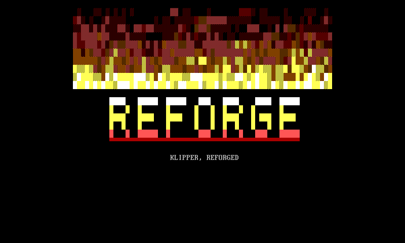
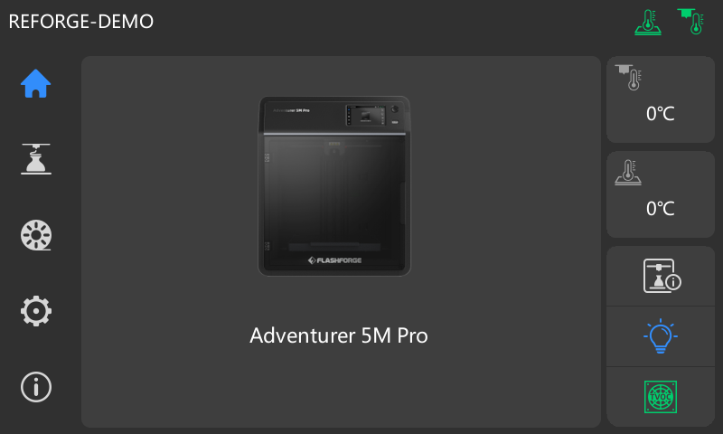
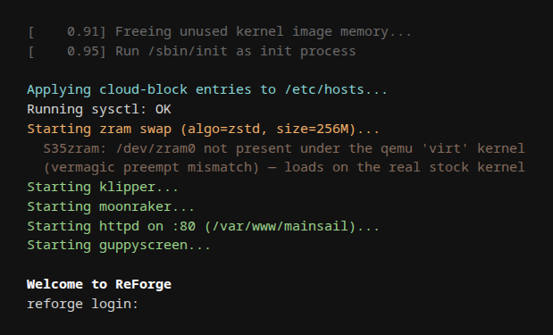

# ReForge

Replacement firmware under development for the **FlashForge Adventurer 5M Pro**
(Allwinner T113-S3, Cortex-A7, 128 MB RAM): upstream Buildroot (glibc) with pinned
Klipper, Moonraker, Mainsail and GuppyScreen. It runs on the stock vendor kernel
today; a mainline kernel and a self-ported T113 display driver are planned.



The **stock FlashForge touch UI runs unmodified on ReForge's upstream Klipper**:
`firmwareExe` is a standard Klipper `api_server` client and needs no proprietary
protocol. `make qemu-stockui-real` proves it in qemu: real Klipper reaches `ready` on
a Linux host MCU and the stock home screen renders against it.



More captures: [`docs/screenshots/`](docs/screenshots/README.md).

## Status

- **qemu:** the full stack builds, boots and serves Moonraker.
- **Hardware (one AD5M Pro):** on 2026-05-31, BSP-built zram modules ran on the stock
  kernel with 4.02× compression ([zram notes](modules/zram-bsp/README.md)). On
  2026-06-02, [live mode](docs/live-mode.md) ran from a USB
  stick with GuppyScreen on the panel, WiFi and SSH up, and left no install state on
  the eMMC. When the MCUs retained another configuration’s CRC (for example after
  Forge-X), Klippy needed a manual relaunch after its first restart; automatic respawn is
  [open](docs/BACKLOG.md#live-klippy-respawn-after-crc-mismatch-auto-restart).
- **`.tgz` install:** validated under qemu only; the loopback test still checks the
  obsolete install layout ([test limits](tests/README.md#loopback-install-test)). It does not stop the stock
  UI yet ([why](#why)).
- **MCU firmware (Plan 4):** the opt-in `klipper13` package builds mainboard and eboard
  firmware from source; flashing and hardware integration are not implemented or
  validated. The default build drives the stock v0.11 MCU firmware.
- **Own kernel (Plan 5):** `make kernel-mainline` builds a T113-scoped Linux 7.3.5 kernel
  as a size proxy. It has no board DTS and has not been booted; it needs
  the toolchain from `make rootfs` or an explicit `CROSS_COMPILE`.

## Quick start

On a Linux host with the packages listed in
[build-process.md](docs/build-process.md#host-requirements):

```sh
git submodule update --init --recursive   # Buildroot + BSP kernel at their pins
make rootfs        # reforge_defconfig -> build/output/images/rootfs.tar
make tgz           # -> packaging/dist/reforge-<ver>.tgz
```

`make rootfs` builds the whole stack (Klipper, Moonraker, Mainsail, GuppyScreen, zram);
`SCREEN_MODE` picks headless or on-screen at runtime. `pins.lock` is the version
manifest. [`vendor/fetch.sh`](vendor/README.md) additionally fetches the standalone
GCC 9.5 crosstool used by the qemu test kernel, `modules/*/build.sh` and
`make bsp-kernel-rebuild`. The [Makefile](Makefile) lists every build and test target.

## Test without a printer

The qemu harness boots a virt-machine kernel built from the same BSP source, with the
framebuffer pinned to the 800×480 panel, and exercises install, boot, the web stack and
the on-screen UI on an x86 host ([harness README](tests/qemu-harness/README.md)).

```sh
mkdir -p vendor/toolchains && ./vendor/fetch.sh   # GCC 9.5 for the test kernel
make qemu-kernel   # build the virt test kernel (one-time, slow)
make qemu-update   # install into an ext4 image, boot it, check ReForge boots (Moonraker LIVE or console FLOOR)
make qemu-render   # capture the GuppyScreen render at 800x480
make qemu-live     # boot live mode from USB, check a legacy install-residue path
```

## Try it on hardware

[Live mode](docs/live-mode.md) boots the stack from a partitioned USB stick without
running the installer. It is not a zero-write mode: the first boot creates an empty
`/reforge` directory on the stock rootfs (eMMC p6), and gcode uploads go to eMMC
`/data` (p7) on purpose. Remove the stick and reboot to leave it.

`make live-usb` writes `packaging/dist/reforge-live-<ver>.img.gz`, a whole-disk image
(MBR, FAT p1, F2FS p2). **Writing it erases the target disk.** Identify the USB disk
with `lsblk` before and after inserting it, unmount all of its partitions, replace
`/dev/sdX`, and never point it at an internal disk.

```sh
make live-usb
version=$(cat packaging/VERSION)
zcat "packaging/dist/reforge-live-${version}.img.gz" | sudo dd of=/dev/sdX bs=4M status=progress conv=fsync
```

## Installing: start from clean stock firmware

The `.tgz` installer expects clean stock firmware. Run the uninstaller of any other mod
(forge-x, Helper Script, zmod, kAIO, or anything that drops files into `/etc/init.d/`,
`/opt/config/`, `/data/.mod/`, `/root/` or `/opt/klipper/klippy/extras/`), reboot, and
confirm `firmwareExe` starts and `/etc/init.d/` has no third-party `S??` symlinks.
A stock USB update can leave mod files behind; it is not a substitute for verified
mod removal. If the uninstaller is unavailable, follow the
[recovery runbook](tools/recovery/RUNBOOK.md) and verify the remaining files before
installing. The installer refuses to run over a known
competing mod; the list and the `REFORGE_FORCE_OVER_OTHER_MOD` override are in
[`packaging/README.md`](packaging/README.md#before-you-install--other-mods-must-be-cleanly-uninstalled).
Live mode needs none of this: it never runs the installer, and it boots on a forge-x
unit.

To restore stock, dump and restore the eMMC with
[`tools/recovery/`](tools/recovery/RUNBOOK.md). Golden images are gitignored and never
committed.

## Why

Reverse-engineering turned up **15 security findings** in the stock Qt UI and supporting userland:
a fleet-wide hardcoded RSA-2048 private key, unauthenticated LAN control on TCP 8899, a
cleartext MQTT cloud control plane, MD5-only OTA verification, hardcoded HMAC secrets,
default `admin/ff123456` credentials, and more. Severity and per-mode closure status:
[`docs/security-findings.md`](docs/security-findings.md).

After successful live startup, the launcher keeps the stock UI from starting, so
those surfaces are absent. Early launcher failure can fall back to the stock UI. The
`.tgz` install does not close them yet: the stock `auto_run.sh` still launches the UI,
and the cloud block edits only the chroot's `/etc/hosts`. The planned
[PID-1 swap](docs/research/kernel/2026-06-05-replacing-pid1.md) keeps the stock UI from
starting without waiting for an own kernel.

## Documentation

| doc | covers |
|---|---|
| [Architecture](docs/architecture.md) | overlay-on-stock chroot model, runtime stack, data flow |
| [Deployment modes](docs/deployment-modes.md) | live USB vs `.tgz` install vs full replacement |
| [Build process](docs/build-process.md) | host requirements, pins, Buildroot, image, `.tgz` |
| [Boot](docs/boot.md) | stock boot chain, intervention points, installed service chain |
| [Live mode](docs/live-mode.md) | USB launcher, write topology, hardware trial |
| [Updates / OTA](docs/ota.md) | git-free updates and last-known-good rollback (`make qemu-ota`) |
| [Optimizations](docs/optimizations.md) | tuning levers and measured RAM/size impact |
| [Repository layout](docs/REPO-LAYOUT.md) | product, vendor and lab trees |
| [Stock DSP reconstruction](lab/dsp-rebrew/README.md) | verified FreeRTOS kernel C component and remaining gaps |
| [All docs](docs/README.md) | index of reference docs, dated research, plans and RE reports |



## Policy and license

The repo commits **no proprietary FlashForge assets** (`firmwareExe`, Qt libraries,
`/opt/PROGRAM/` contents); a CI guard enforces it, and stock-UI investigation extracts
them only into a gitignored scratch area. Development checks and conventions:
[CONTRIBUTING.md](CONTRIBUTING.md).

ReForge's original code is licensed under [GNU GPL version 3](LICENSE)
(`GPL-3.0-only`) unless a file says otherwise. Third-party code, kernel modules, source
excerpts and submodules keep their own licenses; see their headers and provenance docs.
