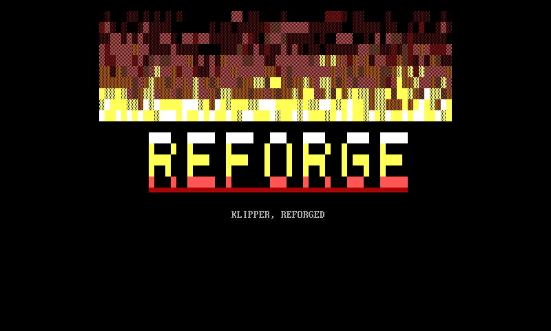
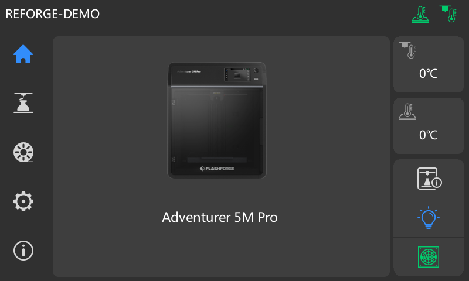

# ReForge

A firmware stack under development for the **FlashForge Adventurer 5M Pro**
(Allwinner T113-S3 / sun8iw20, Cortex-A7). Upstream Buildroot (glibc) +
pinned Klipper / Moonraker / Mainsail / GuppyScreen, built to run on the stock vendor
kernel today and a mainline kernel + self-ported T113 display driver later.



The **stock FlashForge touch UI runs unmodified on ReForge's own upstream Klipper** —
`firmwareExe` is a standard Klipper `api_server` client, so it drives our Klipper over the
shared socket with no proprietary protocol. Proven end-to-end in qemu (`make qemu-stockui-real`):
real Klipper reaches `ready` on a Linux host MCU, the stock home screen renders against it.



(See [`docs/screenshots/`](docs/screenshots/README.md) for the boot console + on-screen UI.)

> **Status:** core stack builds, boots, and serves Moonraker live under qemu (no device
> required). zram compressed swap works on the stock kernel. **Live-from-USB is
> hardware-validated** on a real AD5M Pro — ReForge ran brick-free from a USB stick
> (GuppyScreen on the panel) with **zero eMMC writes** ([live mode](docs/live-mode.md)).
> Still open on hardware: WiFi in live mode, and the host↔MCU Klipper link (klippy needs
> a firmware-version match). MCU firmware (Plan 4) and the full mainline image + display
> driver (Plan 5) are not started.

## Layout

Three trees — **product** (what we author), **vendor** (third-party, pinned), **lab**
(throwaway). Full map: [`docs/REPO-LAYOUT.md`](docs/REPO-LAYOUT.md).

```
br-external/  the firmware (Buildroot BR2_EXTERNAL tree)
modules/      out-of-tree kernel modules (zram, f2fs, overlayfs)
packaging/    stock-format .tgz installer + the live-from-USB launcher
tests/        qemu harness + smoke + loopback install test
tools/        build entry + golden-dump recovery
docs/         specs, plans, research, board notes, screenshots
vendor/       buildroot + BSP kernel (submodules) + toolchain (pinned tarball)
reference/    captured stock and Forge-X printer configs, with provenance
contrib/      work intended for upstream projects
lab/          experiments / scratch (not shipped)
```

## Quick start

```sh
# 1. Get the pinned third-party trees (submodules + verified toolchain tarball)
./vendor/fetch.sh

# 2. Build the single ReForge image (klipper + moonraker + mainsail +
#    guppyscreen + zram). SCREEN_MODE picks headless vs on-screen at runtime.
make rootfs              # reforge_defconfig -> build/output/

# 3. Package the stock-format updater
make tgz                 # -> packaging/dist/reforge-<ver>.tgz
```

`pins.lock` is the authoritative version manifest; `vendor/fetch.sh` reconstructs all
third-party trees at exactly those pins. The [Makefile](Makefile) lists build and test targets.

## How it works (diagrams)

| doc | what |
|---|---|
| [Architecture](docs/architecture.md) | the overlay-on-stock chroot model + the runtime stack + data flow |
| [Build process](docs/build-process.md) | pins → vendor fetch → Buildroot → image → `.tgz` |
| [Boot flow](docs/boot.md) | power-on → `reforge-boot` → service chain → up (with `SKIP_MOD`) |
| [Updates / OTA](docs/ota.md) | git-free in-place updates + the last-known-good rollback (designed) |
| [Live mode](docs/live-mode.md) | run the whole stack from USB, zero eMMC writes — brick-free hardware trials |
| [Optimizations](docs/optimizations.md) | every tuning lever + its measured RAM/size impact |


## Test without a printer

The qemu harness boots a virt-machine kernel (built from the same BSP source) with the
framebuffer pinned to the real 800×480 panel, and exercises install, boot, the web stack,
and the on-screen GUI — all on an x86 host. See
[`tests/qemu-harness/README.md`](tests/qemu-harness/README.md).

```sh
make qemu-kernel         # build the virt test kernel (heavy, one-time)
make qemu-update         # install ReForge into an ext4 + boot it, assert Moonraker live
make qemu-render         # capture the GuppyScreen render at 800x480
make qemu-live           # prove live mode boots from USB and writes ZERO bytes to eMMC
```

## Try it on hardware — no install, no brick risk

[Live mode](docs/live-mode.md) boots the whole stack from a USB stick and **never
writes the eMMC** — pull the stick + reboot to return to pristine stock.

```sh
make live-usb            # -> packaging/dist/reforge-live-<ver>.tar.gz
tar xzf packaging/dist/reforge-live-<ver>.tar.gz -C /path/to/usb/   # extract onto a FAT32 stick
# insert the stick, power on. Remove + reboot for stock.
```

## Before installing (not live-mode): uninstall other mods first

ReForge expects the device to be running **clean stock firmware** before the
first install. If you have another mod present — most commonly **forge-x**,
but the rule applies to **Helper Script / zmod / kAIO** or anything else that
drops files into `/etc/init.d/`, `/opt/config/`, `/data/.mod/`, `/root/`, or
`/opt/klipper/klippy/extras/` — run that mod's uninstaller first, reboot, and
confirm `firmwareExe` starts and `/etc/init.d/` has no third-party `S??`
symlinks. If you don't have the uninstaller, reflash a stock factory `.tgz`
over USB ([RUNBOOK Path A](tools/recovery/RUNBOOK.md)) for a known-clean
baseline. Live-mode trials (above) are unaffected — they don't touch eMMC.

ReForge's installer pre-flights this and refuses to proceed if a known
competing mod is detected. See
[`packaging/README.md`](packaging/README.md#before-you-install--other-mods-must-be-cleanly-uninstalled)
for the full list, the rationale, and the `REFORGE_FORCE_OVER_OTHER_MOD`
override if you know what you're doing.

## Recovery

The printer's stock state can be dumped and restored via the tooling in
[`tools/recovery/`](tools/recovery/RUNBOOK.md). Golden images are large and **never
committed** (gitignored).

## Why

Reverse-engineering the stock firmware turned up **15 security findings** in the QT4
stock UI binary alone — fleet-wide hardcoded RSA-2048 private key, unauthenticated
LAN raw-TCP control on :8899, cleartext MQTT cloud control plane, MD5-only OTA
verification, hardcoded HMAC secrets, default `admin/ff123456` credentials, and more.
Full list with severity + closure status per ReForge mode: [`docs/security-findings.md`](docs/security-findings.md).

ReForge's cloud-block + replacement of the stock UI closes the cloud-side of those
findings today; the planned PID-1 swap (`docs/research/kernel/2026-06-05-replacing-pid1.md`)
closes the LAN-side ones without waiting for our own kernel.

## Policy

This repo commits **zero proprietary FlashForge assets** (`firmwareExe`, Qt blobs,
`/opt/PROGRAM/` contents) — a CI guard enforces it. Stock-UI investigation extracts those
only into a gitignored scratch area.

For development checks and contribution guidelines, see [CONTRIBUTING.md](CONTRIBUTING.md).

## License

ReForge's original code is licensed under [GNU GPL version 3](LICENSE)
(`GPL-3.0-only`), except where a file specifies another license. Third-party code,
kernel modules, source excerpts, and submodules retain their existing licenses;
see their license headers and provenance documentation.
