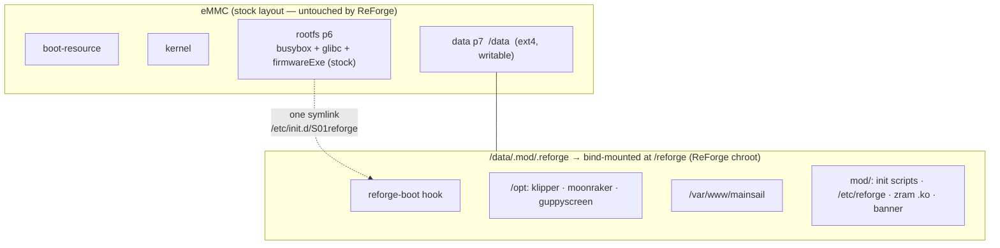
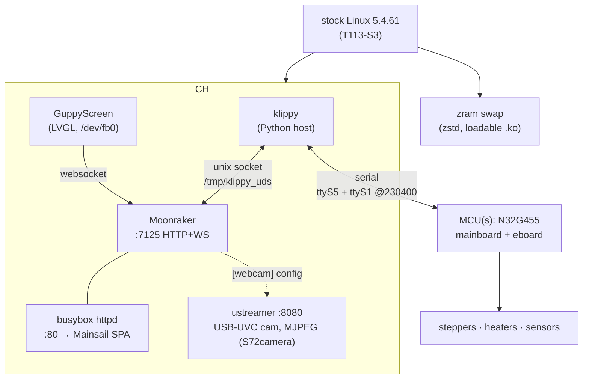
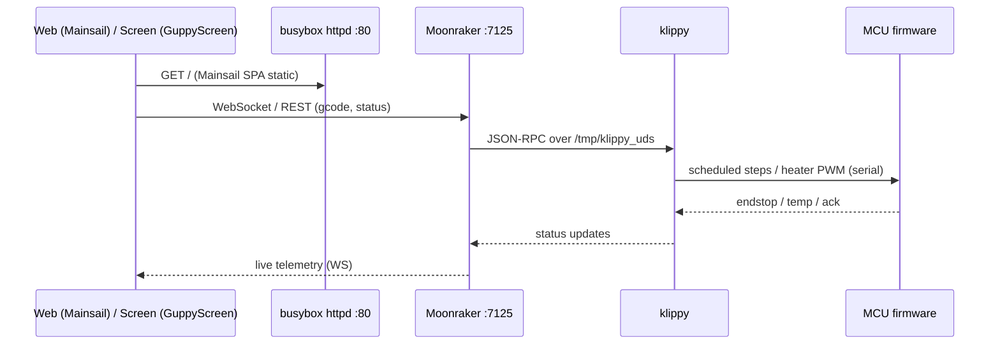

# ReForge architecture

ReForge is a from-scratch firmware **userland** for the FlashForge Adventurer 5M Pro
(Allwinner T113-S3, dual Cortex-A7, 128 MB RAM). For P1–P3 it runs on the **stock vendor
kernel** (Linux 5.4.61) as an **overlay on the stock firmware** — the stock SPL/U-Boot/kernel
are untouched; ReForge installs under the writable `/data/.mod/.reforge`, is bind-mounted onto a
`/reforge` mountpoint at boot, and runs chrooted there — reached by a single
`/etc/init.d/S01reforge` symlink. Plan 5 later swaps in a mainline kernel + U-Boot.

## Storage / overlay model

The base rootfs (busybox/glibc) inside the chroot is built fresh by Buildroot (glibc, Thumb-2/
-Os). The stock `firmwareExe` on p6 stays available — `SKIP_MOD` boots it (dual-boot).

**Live mode** reuses this exact chroot model and the same `/reforge` mountpoint, but the
rootfs comes from an **F2FS partition on the USB stick** instead of a bind of
`/data/.mod/.reforge`. The printer's eMMC `/data` (p7) is still bind-mounted into the chroot,
so gcode uploads persist; the only OS-level eMMC write is the one-time `mkdir /reforge` on the
stock p6 rootfs (p7 untouched — no install residue). Pull the stick + reboot → pristine stock.
See [live mode](live-mode.md).

## Runtime stack

Single shared Python interpreter for klippy + moonraker (COW page sharing). **jemalloc**
(`LD_PRELOAD` + tuned `MALLOC_CONF=narenas:1,dirty_decay_ms:0,muzzy_decay_ms:0`) is used for
**moonraker and guppyscreen only** — klippy runs with the default allocator, because jemalloc's
`LD_PRELOAD` corrupts klippy's `c_helper.so` heap on real hardware (it aborts with `free(): invalid
size`). See [optimizations](optimizations.md). The camera is **ustreamer** serving MJPEG on `:8080`
(`S72camera`), exposed to the UI via Moonraker's `[webcam]`. The on-screen UI is **runtime-selectable** via
`SCREEN_MODE` (`GUPPY` = GuppyScreen, `HEADLESS` = web-only, `STOCK` = the stock `firmwareExe`,
feasibility-confirmed). **The MCUs are Nationstech N32G455 running FlashForge's stock Klipper v11
firmware — ReForge's host Klipper drives them as-is** (proven on hardware: both MCUs connect, real
temps, klippy `ready`). Plan 4 (matching MCU firmware) is **not** required to move the printer; it
only restores the version-locked adxl345/input-shaper *calibration* (the `query_adxl345` command
format changed v11→v13). See [MCU firmware & config](reverse-engineering/ad5m-mcu-firmware-and-config.md).

## Control / data flow (a print command)

Mainsail talks to Moonraker **directly** on `:7125` (CORS-allowed) — busybox httpd only serves
the static SPA, so there's no reverse proxy (nginx removed, ~3 MB saved).

## Where things live

| concern | path | doc |
|---|---|---|
| firmware (Buildroot external tree) | `br-external/` | [build process](build-process.md) |
| kernel modules (zram · f2fs · overlay; later display) | `modules/` (zram-bsp, f2fs-bsp, overlay-bsp) | `modules/zram-bsp/README.md` |
| packaging (USB `.tgz`) | `packaging/` | — |
| boot hook + overlay | `br-external/board/reforge/rootfs-overlay/` | [boot](boot.md) |
| updates | Moonraker zip/web updaters + CI release tooling (shipped) | [OTA](ota.md) |
| camera | ustreamer MJPEG `:8080` | `etc/init.d/S72camera` |
| run-from-USB (no install) | `packaging/live/`, `modules/f2fs-bsp/` | [live mode](live-mode.md) |
| third-party (pinned) | `vendor/` | `vendor/README.md` |

## Deployment modes

ReForge has three deployment modes by increasing commitment: **Mode 1 live**
(USB-booted, zero-touch — future, OverlayFS-gated), **Mode 2 install-on-stock**
(the shipped `/data/.mod/.reforge` overlay described above), and **Mode 3 full
replacement** (own kernel + rootfs — Plan 5). Full taxonomy + installer paths:
[deployment-modes.md](deployment-modes.md).

## Phases

| phase | scope | status |
|---|---|---|
| P1–P3 | core stack on stock kernel; builds/boots/serves in qemu; packaging; validation | **done** |
| OTA | git-free in-place updates (Moonraker zip/web updaters, CI release bundles, N=3 trial/LKG) | **done** ([OTA](ota.md); [spec](specs/2026-06-01-reforge-ota-design.md)) |
| Plan 4 | matching MCU firmware (mainboard + eboard) — **optional**: the stock v11 MCU already drives the printer; Plan 4 restores adxl345/input-shaper calibration (or moves to v13) | not started |
| Plan 5 | mainline U-Boot + 6.12 LTS kernel + ported T113 display driver | researched ([notes](research/kernel/2026-06-01-t113-mainline-kernel-support.md)) |
