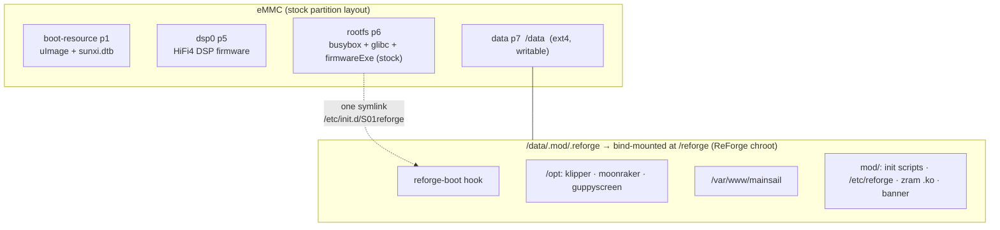
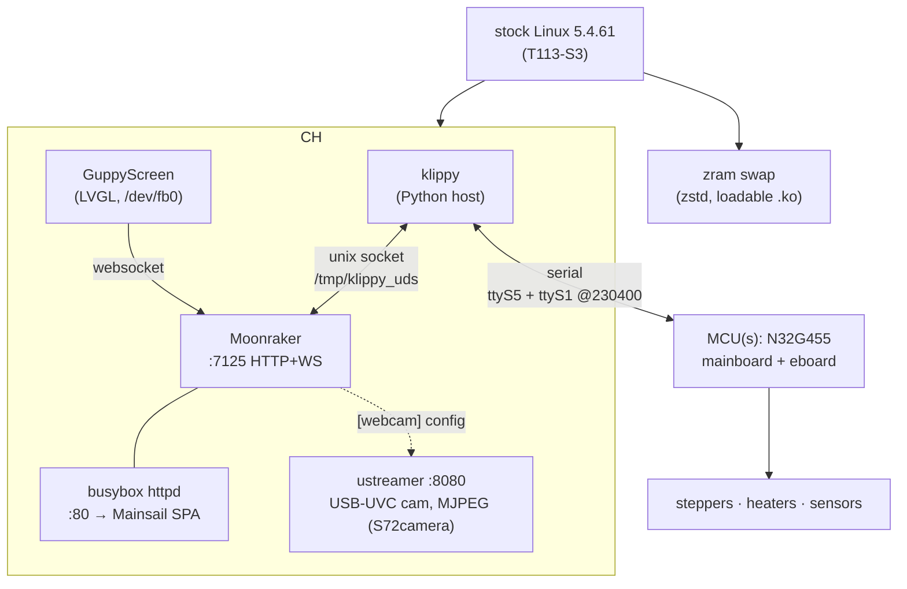
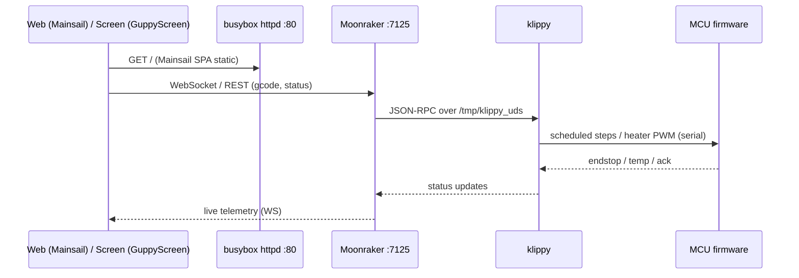

# ReForge architecture

ReForge is a from-scratch firmware **userland** for the FlashForge Adventurer 5M Pro
(Allwinner T113-S3, dual Cortex-A7, 128 MB RAM). For P1–P3 it runs on the **stock vendor
kernel** (Linux 5.4.61) as an **overlay on the stock firmware** — the stock SPL/U-Boot/kernel
are untouched; ReForge installs under the writable `/data/.mod/.reforge`, is bind-mounted onto a
`/reforge` mountpoint at boot, and runs chrooted there — reached by a single
`/etc/init.d/S01reforge` symlink. Plan 5 later swaps in a mainline kernel + U-Boot.

## Storage / overlay model

The base rootfs (busybox/glibc) inside the chroot is built fresh by Buildroot (glibc, Thumb-2/
-Os). The stock `firmwareExe` on p6 stays in place. `SKIP_MOD` or `SCREEN_MODE=STOCK`
skips ReForge (`/tmp` markers for that boot; the `/data` marker and `STOCK` setting
until removed). Otherwise `reforge-boot` returns after starting the services and the stock `auto_run.sh` still launches the stock UI (see
[security findings](security-findings.md)).

**Live mode** reuses this exact chroot model and the same `/reforge` mountpoint, but the
rootfs comes from an **F2FS partition on the USB stick** instead of a bind of
`/data/.mod/.reforge`. The printer's eMMC `/data` (p7) is still bind-mounted into the chroot,
so gcode uploads persist. The launcher creates host mountpoints on p6 when absent;
optional services such as HELIX also write to p7. On the 2026-06-02 trial, pulling
the stick and rebooting left no install residue. See [live mode](live-mode.md).

## Runtime stack

Klippy and Moonraker run as separate processes using the same Python interpreter binary. **jemalloc**
(`LD_PRELOAD` + tuned `MALLOC_CONF=narenas:1,dirty_decay_ms:0,muzzy_decay_ms:0`, plus `tcache:false`
for moonraker) is used for
**Moonraker, GuppyScreen and optional HelixScreen** — klippy runs with the default allocator, because jemalloc's
`LD_PRELOAD` corrupts klippy's `c_helper.so` heap on real hardware (it aborts with `free(): invalid
size`). See [optimizations](optimizations.md). The camera is **ustreamer** serving MJPEG on `:8080`
(`S72camera`), exposed to the UI via Moonraker's `[webcam]`. The on-screen UI is **runtime-selectable** via
`SCREEN_MODE`: `GUPPY` = GuppyScreen, `HEADLESS` = web-only, `HELIX` = HelixScreen (only when
built in), `STOCK` = skip ReForge and boot the stock firmware. Installs default to `HEADLESS`
(`config/screen.conf`); live mode defaults to `GUPPY`. **The MCUs are Nationstech N32G455 running FlashForge's stock Klipper v11
firmware — ReForge's host Klipper drives them as-is**. In the 2026-06-02 live trial,
both MCUs connected, reported temperatures and reached klippy `ready`. When the
MCUs retained another configuration's CRC (for example after Forge-X), klippy
needed a manual relaunch after its first restart. `S60klipper` does not
respawn klippy; see the [open startup issue](BACKLOG.md#live-klippy-respawn-after-crc-mismatch-auto-restart).
Plan 4 is not required for that MCU link. The earlier claim that `query_adxl345`
changed between v0.11 and v0.13 was corrected on 2026-06-04; see
[MCU firmware & config](reverse-engineering/ad5m-mcu-firmware-and-config.md).

## Control / data flow (a print command)

Mainsail talks to Moonraker **directly** on `:7125` (CORS-allowed) — busybox httpd only serves
the static SPA, so there's no reverse proxy (nginx removed, ~3 MB saved).

## Where things live

| concern | path | doc |
|---|---|---|
| firmware (Buildroot external tree) | `br-external/` | [build process](build-process.md) |
| kernel modules | zram: `br-external/package/reforge-zram/` (built from the BSP); f2fs, overlay: `modules/` | [`modules/zram-bsp/README.md`](../modules/zram-bsp/README.md) |
| packaging (USB `.tgz`) | `packaging/` | [`packaging/README.md`](../packaging/README.md) |
| boot hook + overlay | `br-external/board/reforge/rootfs-overlay/` | [boot](boot.md) |
| updates | Moonraker zip/web updaters + CI release tooling (shipped) | [OTA](ota.md) |
| camera | ustreamer MJPEG `:8080` | `etc/init.d/S72camera` |
| run-from-USB (no install) | `packaging/live/`, `modules/f2fs-bsp/` | [live mode](live-mode.md) |
| third-party (pinned) | `vendor/` | `vendor/README.md` |

## Deployment modes

ReForge has three deployment modes by increasing commitment: **Mode 1 live**
(USB-booted, zero-touch — future, OverlayFS-gated), **Mode 2 install-on-stock**
(the shipped `/data/.mod/.reforge` overlay described above), and **Mode 3 full
replacement** (own kernel + rootfs — Plan 5). Full taxonomy + installer paths:
[deployment-modes.md](deployment-modes.md). Which stock attack surfaces each mode
closes: [security-findings.md](security-findings.md).

## Phases

| phase | scope | status |
|---|---|---|
| P1–P3 | core stack on stock kernel; builds/boots/serves in qemu; packaging; validation | **done** |
| OTA | git-free in-place updates (Moonraker zip/web updaters, CI release bundles, N=3 trial/LKG) | **done** ([OTA](ota.md); [spec](specs/2026-06-01-reforge-ota-design.md)) |
| Plan 4 | matching MCU firmware (mainboard + eboard); **optional** for the demonstrated stock-MCU link | opt-in `klipper13` package builds both firmwares from source ([build](build-process.md#optional-klipper-v013-host)); flashing and hardware integration not implemented or validated |
| Plan 5 | mainline U-Boot + mainline kernel + ported T113 display driver | [Research](research/kernel/2026-06-01-t113-mainline-kernel-support.md) and a [T113 kernel size proxy](research/kernel/2026-10-27-mainline-board-kernel.md). Board DTS and boot validation are open. |
