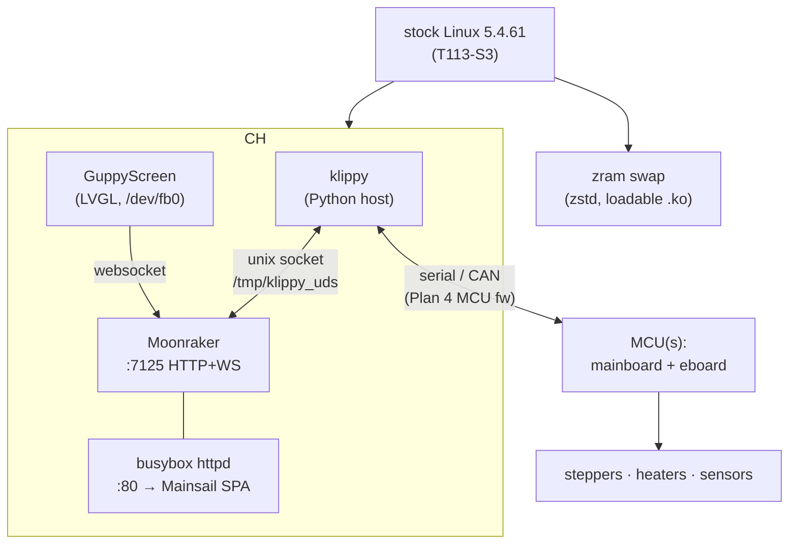
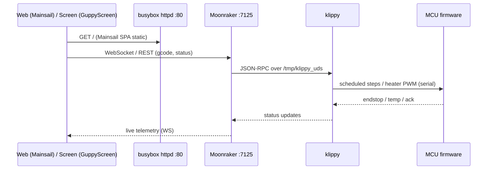

# ReForge architecture

ReForge is a from-scratch firmware **userland** for the FlashForge Adventurer 5M Pro
(Allwinner T113-S3, dual Cortex-A7, 128 MB RAM). For P1–P3 it runs on the **stock vendor
kernel** (Linux 5.4.61) as an **overlay on the stock firmware** — the stock SPL/U-Boot/kernel
are untouched; everything ReForge lives in the writable `/data/.reforge` chroot, reached by a
single `/etc/init.d/S01reforge` symlink. Plan 5 later swaps in a mainline kernel + U-Boot.

## Storage / overlay model

The base rootfs (busybox/glibc) inside the chroot is built fresh by Buildroot (glibc, Thumb-2/
-Os). The stock `firmwareExe` on p6 stays available — `SKIP_MOD` boots it (dual-boot).

## Runtime stack

Single shared Python interpreter for klippy + moonraker (COW page sharing); `MALLOC_ARENA_MAX=2`
on both (+ guppyscreen) for RAM. The on-screen UI is **runtime-selectable** via `SCREEN_MODE`
(`GUPPY` = GuppyScreen, `HEADLESS` = web-only, `STOCK` = the stock `firmwareExe`, feasibility-
confirmed). MCU firmware (Plan 4) is what makes a flashed unit actually move.

## Control / data flow (a print command)

Mainsail talks to Moonraker **directly** on `:7125` (CORS-allowed) — busybox httpd only serves
the static SPA, so there's no reverse proxy (nginx removed, ~3 MB saved).

## Where things live

| concern | path | doc |
|---|---|---|
| firmware (Buildroot external tree) | `br-external/` | [build process](build-process.md) |
| kernel modules (zram; later display) | `modules/` | `modules/zram-bsp/README.md` |
| packaging (USB `.tgz`) | `packaging/` | — |
| boot hook + overlay | `br-external/board/reforge/rootfs-overlay/` | [boot flow](boot-flow.md) |
| updates | (designed) | [OTA](ota.md) |
| third-party (pinned) | `vendor/` | `vendor/README.md` |

## Phases

| phase | scope | status |
|---|---|---|
| P1–P3 | core stack on stock kernel; builds/boots/serves in qemu; packaging; validation | **done** |
| OTA | git-free in-place updates | designed ([spec](specs/2026-06-01-reforge-ota-design.md)) |
| Plan 4 | MCU firmware (mainboard + eboard) — makes a flashed unit drive the printer | not started |
| Plan 5 | mainline U-Boot + 6.12 LTS kernel + ported T113 display driver | researched ([notes](research/2026-06-01-t113-mainline-kernel-support.md)) |
