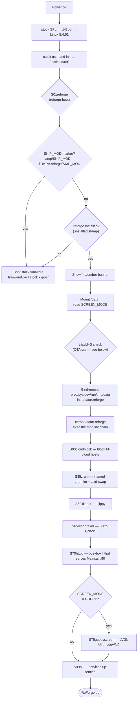

# ReForge boot flow

How an Adventurer 5M Pro boots into ReForge. ReForge installs as an **overlay on the stock
firmware**: the stock SPL → U-Boot → Linux 5.4.61 → stock userland init are untouched; the
**only** persistent change is one symlink, `/etc/init.d/S01reforge` → the ReForge boot hook.
Everything ReForge lives under the writable `/data/.reforge` chroot.

## Sequence

## What runs, in order

| step | what | source |
|---|---|---|
| `S01reforge` | the boot hook (chroots into `/data/.reforge`) | `board/reforge/rootfs-overlay/.shell/reforge-boot` |
| `SKIP_MOD` gate | a USB/`/tmp` marker forces a pure stock boot (escape hatch) | `reforge-boot` |
| banner | the fire/ember "ReForge" bootsplash | `usr/bin/reforge-banner` ([screenshot](screenshots/reforge-bootsplash.png)) |
| `S00cloudblock` | append FF cloud hosts to `/etc/hosts` (block telemetry/OTA) | overlay `etc/init.d/S00cloudblock` |
| `S35zram` | insmod `zram.ko`/`zsmalloc.ko`, zstd compressed swap, swappiness=100 | `modules/zram-bsp/` |
| `S60klipper` | klippy (host), `MALLOC_ARENA_MAX=2` | overlay `etc/init.d/S60klipper` |
| `S65moonraker` | Moonraker API + WebSocket on `:7125`, `MALLOC_ARENA_MAX=2` | overlay `etc/init.d/S65moonraker` |
| `S70httpd` | busybox httpd serves the Mainsail SPA on `:80` (Mainsail → Moonraker direct) | overlay `etc/init.d/S70httpd` |
| `S75guppyscreen` | LVGL touch UI on the panel — only when `SCREEN_MODE=GUPPY` | overlay `etc/init.d/S75guppyscreen` |
| `S99ok` | services-up sentinel (OTA era: promote `mod`→LKG) | planned (OTA) |

The boot console for this sequence: [screenshot](screenshots/reforge-boot-console.png).

## Dual-boot / recovery

- **`SKIP_MOD`** (a marker on USB or `/tmp`) → ReForge steps aside and the **stock firmware
  boots** — the always-available escape hatch.
- The single `S01reforge` symlink is the only stock change, so uninstall = remove the symlink.

## OTA-era additions (planned, see OTA design)

Once OTA ships ([`docs/ota.md`](ota.md)), `reforge-boot` runs the mod init **from the OTA-managed
`/data/.reforge/mod` dir in place** and adds a **trial/last-known-good (LKG)** guard around it:
a freshly-updated `mod` boots on a trial counter; reaching `S99ok` promotes it to LKG, and if it
fails to come up N=3 times the previous LKG is restored. Details + diagram in
[`docs/ota.md`](ota.md).
