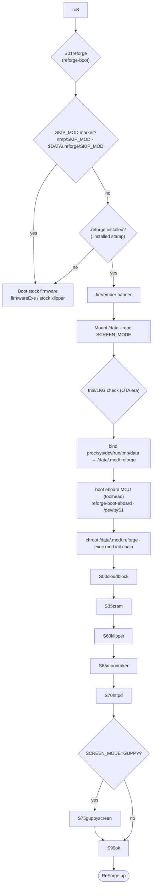

# ReForge boot — stock chain, hooks, intervention & the installed service chain

> **For the eMMC partition layout** (GPT offsets, sizes, filesystems, mountpoints,
> brick-safety tier per partition), see [`board-notes/partition-map.md`](board-notes/partition-map.md).
> Section 5 below references partitions by name only; the canonical numbers live there.

**Date:** 2026-06-02
**SoC:** Allwinner T113-S3 (sun8iw20p1), dual Cortex-A7, 128 MB DRAM.
**Status:** reference — verified read-only against the live printer + the eMMC dumps.

The single boot reference. §1–§6 cover the **stock/forge-x substrate**: the BROM→init
chain, where (and how reversibly) we can intervene, how forge-x hooks in, and how the
stock firmware detects a USB update `.tgz` (the mechanism live-mode + the installer ride
on). §7 covers the **installed-ReForge boot** (the chroot service chain). Live-mode boot
is its own topic — see [live-mode.md](live-mode.md).

---

## 1. The boot chain (verified)

```
BROM (mask ROM in silicon; FEL USB recovery)
  → boot0 / SPL (eGON)            raw eMMC, sectors 0..73727 (~36 MB before p1)
  → U-Boot 2018.05                env on p2 (+ p3 redundant)
  → kernel  (boot.img @ p4, "ANDROID!" image format: kernel+dtb+ramdisk)
       cmdline: root=/dev/mmcblk0p6 init=/init console=ttyS3,115200 cma=16M
                androidboot.hardware=sun8iw20p1 androidboot.dramsize=128 ...
  → /init  →  symlink to /bin/busybox     (busybox init)
  → /etc/inittab:
       ::sysinit:/etc/preinit             ← FIRST userspace action (file ABSENT = unused)
       ::sysinit:/bin/mount -t proc ...
       ::sysinit:/bin/mount -o remount,rw /
       ::sysinit:/bin/mount -a
       ::sysinit:/sbin/swapon -a
       ... → /etc/init.d/rcS
              # 1. Set MAC + ifconfig eth0
              # 2. Loop /etc/init.d/S??*  (sorted)
              S00init       (stock: empty no-op; FORGE-X replaces with symlink → /opt/config/mod/.shell/S00init)
              S01syslogd S02klogd S10udev S20urandom S30dbus S40network
              S50postgresql S50telnet S80dnsmasq
              # (forge-x adds: S55boot S60dropbear S98camera S98zssh S99root)
              # (ReForge install adds: S01reforge → /data/.mod/.reforge/.shell/reforge-boot)
              # 3. /etc/adb_conf.sh start &        (Android adb daemon, backgrounded)
              # 4. tinymix audio routing
              # 5. libcrypto/libssl 1.0.0 → 1.1 compat symlinks
              # 6. /opt/auto_run.sh &              ← STOCK USB/update detection (LAST line; backgrounded)
  → rcS returns → inittab continues → getty on ttyS3 (respawned)
```

The last line of `rcS` is `/opt/auto_run.sh &` — backgrounded, so `rcS` returns
immediately and `inittab` proceeds to spawn `getty`. `auto_run.sh` continues to
run in parallel: it does the USB-update scan, then the MCU-firmware-update check,
then launches the stock UI (`ffstartup-arm`). See §4 for the full timeline.

Partition map (GPT): `p1 boot-resource(33.6M) · p2 env(1M) · p3 env-redund(1M) ·
p4 boot(34.4M) · p5 dsp0(1M) · p6 rootfs(1.3G) · p7 UDISK/data(5.9G)`.

---

## 2. Intervention points — earliest → latest

| # | Stage | Hook method | Reversible | Risk |
|---|-------|-------------|-----------|------|
| 0 | **BROM FEL** | `xfel`/`sunxi-fel` over USB0 (BROM enters FEL if boot0 fails, FEL trigger held, or U-Boot runs `efex`) | n/a (RAM-only) | **recovery / kernel-test context**, not a standing hook. On this unit needs **two solder mods** (USB0 internal pad → ext. connector; 3.3 V UART for `efex` entry). See [`research/kernel/2026-06-04-brick-safe-kernel-test-paths.md`](research/kernel/2026-06-04-brick-safe-kernel-test-paths.md). |
| 1 | boot0 / SPL (eGON) | reflash raw eMMC sectors 0..73727 | only via FEL | **BRICK** (FEL never rehearsed) |
| 2 | U-Boot binary | reflash boot0/uboot area | only via FEL/SPL | **BRICK** |
| 3 | **U-Boot env (p2/p3)** | **`fw_setenv`** — edit `bootargs`/`bootcmd`/`init=`, or add a `boot.scr` | **ONLY if it still boots to a shell** — see ⚠ below | **HIGH on this unit** — a bad `init=`/`bootargs`/`bootcmd` boots U-Boot+kernel but kills userspace; with **no UART + no FEL** there's no in-band fix → **eMMC-reader hard-brick** |
| 4 | boot.img (p4) | repack the Android kernel+ramdisk+cmdline | reflash p4 | medium |
| 5 | **`init=` override** | env `init=` → our PID1 script (which `pivot_root`s, then `exec /sbin/init`). See `research/kernel/2026-06-05-replacing-pid1.md` §A2. | YES (env) | low–med ⭐ earliest *userspace control* |
| 5a | **`/init` symlink swap** — "Option A" | rewrite the `/init` symlink on p6 to point at our PID1 script (kernel `execve`s `/init` by default). Cleaner than #5 because we modify a file on p6 (SAFE tier) instead of U-Boot env (HARD-BRICK tier on this unit). See `research/kernel/2026-06-05-replacing-pid1.md` §A1 + `br-external/board/reforge/rootfs-overlay/sbin/reforge-init`. | YES (file on p6) | LOW ⭐ **recommended Mode-2 PID-1 hook** |
| 6 | **/etc/preinit** — "Option C" | create the file (absent today) → runs before mounts/swap/net/rcS as a busybox-init sysinit child. **Cannot cleanly replace PID 1** (busybox-init is already running) but useful for *additive* early hooks. See `research/kernel/2026-06-05-replacing-pid1.md` §B + footnote on preinit. | YES (file on p6) | LOW ⭐ earliest *safe userspace* on the stock flow |
| 7 | /etc/inittab, rcS, S00init | add a sysinit line / rc script (forge-x owns S00init) | YES (file) | low |
| 8 | /opt/auto_run.sh (rcS tail, backgrounded) | the USB-launcher hook ReForge-live uses today | YES | trivial — but **latest** |

### Practical conclusions
- **Earliest possible code:** BROM **FEL** (USB) — before any eMMC code, but a
  recovery/injection path, not a persistent boot modification.
- **Earliest persistent code:** boot0/SPL — reflash → brick risk, FEL recovery never
  rehearsed → **off-limits in practice**.
- **Earliest userspace-controlling pre-kernel hook:** the **U-Boot environment on p2**
  (`fw_setenv`; `/etc/fw_env.config` maps `mmcblk0p2 0x0 0x20000` + p3). BUT it is **NOT
  a safe hook on this unit** — see ⚠ below. Only the *value* is reversible, and only if
  the new value still boots to a shell.
- **Earliest TRULY SAFE hook:** create **`/etc/preinit`** (inittab calls it first; it
  doesn't exist today). A broken `/etc/preinit` is **non-fatal** — busybox init logs the
  error and continues to the next sysinit line, so the box still boots to SSH and you
  revert with `rm /etc/preinit`. This is the right place for early experiments.

> ⚠ **Brick reality (no FEL, no UART on this unit as shipped — `tools/recovery/RUNBOOK.md`).**
> Both are *gated behind hardware mods*, not silicon-absent: the T113-S3 BROM exposes FEL
> on USB0 (internal JST PH2.0 pad, requires soldering an external connector) and the
> board has UART0 console pads next to USB0 (requires a 3.3 V USB-UART adapter). Once
> both mods are in, FEL becomes a brick-safe kernel-test path and `fw_setenv` becomes
> in-band recoverable from the U-Boot prompt. Recipe + workflow:
> [`research/kernel/2026-06-04-brick-safe-kernel-test-paths.md`](research/kernel/2026-06-04-brick-safe-kernel-test-paths.md).
> A bad `init=`/`bootargs`/`bootcmd` set via `fw_setenv` does NOT corrupt U-Boot, so
> U-Boot + the kernel still run — but userspace never starts. You then have **no SSH**
> (no userspace), **no U-Boot prompt** (no UART), **no FEL** (USB). That is a hard-brick
> recoverable ONLY by Path B: open the enclosure, attach an eMMC reader, and
> `gzip -dc tools/recovery/golden.img.gz | sudo dd of=/dev/<reader-dev> bs=4M conv=fsync`.
> The redundant p3 copy only protects against a *bad CRC* (U-Boot then falls back to its
> compiled-in defaults); it does NOT protect against a *valid-but-wrong* value, which is
> what `fw_setenv` writes. Therefore: do NOT change boot-critical env vars on this unit
> until the eMMC-reader golden-restore has been rehearsed end-to-end. Prefer `/etc/preinit`
> (#6) for early hooks; reserve `init=` overrides for after recovery is proven + with a
> wrapper that `exec /init` on any error.

### Early `switch_root` (re: the earlier discussion)
ReForge-live hooks at `auto_run.sh` (#8) — deep under stock init, not PID1, so a real
`switch_root` doesn't fit *there*. But via the **env `init=` override (#3→#5)** the
kernel execs *us* as PID1 before mounts; from there `switch_root`/`pivot_root` into a
ReForge rootfs is clean — and reversible by restoring the env (no bootloader/kernel
reflash, so brick-safety holds). That is the architecturally-correct place for an early
switch_root, not `auto_run`.

---

## 3. How forge-x hooks the boot

`/etc/init.d/S00init` is a **symlink → `/opt/config/mod/.shell/S00init`** — forge-x
**replaces** the stock S00init, so it runs **first** in the rcS sequence. Its S00init:
- sources `/opt/config/mod/.shell/common.sh`
- `handle_special_boot_mode` → `boot/init_boot_flag.sh apply` (special boot modes)
- `handle_boot_options` — the **dual-boot / failsafe** gate:
  - `BOOT_SKIP_F` present → `touch /tmp/SKIP_MOD_SOFT`, return 1 → **stock loads** (user-requested skip)
  - `BOOT_FAILURE_F` present → `touch /tmp/SKIP_MOD_HARD`, return 1 → **stock loads** (boot-failure failsafe)
- otherwise → sets up the forge-x chroot (`/data/.mod/.forge-x`) + launches its stack.

So forge-x's takeover mechanism = **own the S00init symlink**, with `SKIP_MOD`
soft/hard escape hatches. (ReForge's installer mirrors this `SKIP_MOD` pattern.)
Full forge-x chroot/service teardown: [board-notes/forge-x-boot-architecture.md](board-notes/forge-x-boot-architecture.md).

Note `/opt/auto_run.sh` (the last line of rcS) is the *stock* script and **still runs** even with
forge-x installed — which is exactly why ReForge live-mode (a USB `flashforge_init.sh`)
works on a forge-x box.

---

## 4. How stock FW detects a USB update `.tgz`  (`/opt/auto_run.sh`)

**Where in the boot chain:** the **last line of `/etc/init.d/rcS`**, invoked as
`/opt/auto_run.sh &` — i.e. **after** every `S??*` init script has run, **after**
the rcS-tail cleanup (adb, tinymix, compat symlinks), and **backgrounded** so
`rcS` returns immediately. The stock UI launch lives **inside** `auto_run.sh`,
at the very end, so it doesn't appear until `auto_run.sh` is done with its USB
scan + MCU update check. That's the ordering hook ReForge-live + the installer
ride on — we get a chance to claim the box *before* the UI ever launches.

The full timeline inside `auto_run.sh` (`MACHINE=Adventurer5MPro`, `PID=0024`):

1. **Mount /data** (mmcblk0p7) if not already mounted (`fsck -y` first); clear
   `/data/update`.
2. **WiFi up:** `insmod /lib/modules/8821cu.ko` then `sleep 2` to give the USB
   bus time to enumerate any inserted stick.
3. **USB scan loop:** for `i in 1 2 3 4`, try `mount -t vfat
   -o,codepage=936,iocharset=utf8 /dev/sda$i /mnt` (also tries the bare `/dev/sda`
   if no partition node exists). Per successful mount, check **in this priority
   order**:
   - **(a) Update-tarball path** — `ls -1t /mnt/Adventurer5MPro-*.tgz` (newest
     wins). If a tarball matches:
     1. `cp ${UPDATEFILE} /data/`
     2. `mkdir -p /data/update`
     3. `tar -xvf /data/Adventurer5MPro-*.tgz -C /data/update/`
     4. **`/data/update/flashforge_init.sh Adventurer5MPro 0024`**
     5. **on exit 0:** `umount /mnt; rm -rf /data/update; sleep 100000`
        — i.e. the loop is broken AND auto_run.sh is parked forever, so the
        MCU update check + stock UI launch below NEVER happen. This is how
        an install hook "claims" the box.
   - **(b) Direct-script path** — only if (a) didn't match: if
     `/mnt/flashforge_init.sh` exists, `chmod a+x` + run
     **`/mnt/flashforge_init.sh Adventurer5MPro 0024`** directly from the USB.
     On exit 0 → `umount /mnt; sleep 100000` (same claim semantics).
4. **After the USB scan loop:** `/opt/klipper/usb_map.sh`
   (toolhead serial port mapping).
5. **MCU-firmware update check:** if `/opt/PROGRAM/control/<latest>/Update`
   flag present, `cd` there and run `./run.sh`, then `reboot -f`. (This is the
   FlashForge mechanism for re-flashing the N32G455 MCU firmware.)
6. **Stock UI launch:** `/opt/PROGRAM/ffstartup-arm -f /opt/PROGRAM/ffstartup.cfg &`
   — the QT touchscreen UI. This is the LAST thing `auto_run.sh` does, and only
   if nothing above blocked the flow.

So a tarball or `flashforge_init.sh` that returns 0 will preempt the stock UI
entirely. A non-zero return falls through to the MCU update check + UI.

### The contract ReForge rides on
- **No signature check.** Detection is purely by filename / file presence.
- **Two install hooks:** a tarball named **`Adventurer5MPro-*.tgz`** (extracted, its
  inner `flashforge_init.sh` runs) **or** a bare **`/mnt/flashforge_init.sh`** at the
  USB root (run directly). Both get args `Adventurer5MPro 0024`.
- **Exit-code semantics:** `flashforge_init.sh` exit **0 → stock `sleep 100000`** (the
  launcher owns the box → this is how live-mode blocks stock); **non-zero → stock falls
  through** to `ffstartup-arm` (stock UI). ReForge-live returns 0 to hold; the installer
  installs then returns appropriately.
- **MCU flashing path:** `/opt/PROGRAM/control/<ver>/Update` + `run.sh` + reboot is how
  stock flashes the MCU firmware — the mechanism to reuse for v11↔v13 MCU switching.

---

## 5. Recipes (brick-safety boundary)

**Brick-safety on this unit (no FEL, no UART) has only TWO tiers:**
- **SAFE — revertible over SSH:** changes to **files on the rootfs (p6)** — `/etc/preinit`,
  inittab, rc scripts, `/opt/auto_run.sh`. If they misbehave the box still boots to a
  shell (or stock), so you `rm`/edit them back. Worst case, reflash a stock `.tgz` over
  USB (RUNBOOK Path A — needs userspace to reach `auto_run.sh`).
- **NOT SAFE — eMMC-reader recovery only:** the **U-Boot env (p2/p3)** and anything below
  it (U-Boot, boot0, boot.img). A bad value here can stop userspace, and with no UART/FEL
  the only fix is RUNBOOK **Path B** (open case → eMMC reader → `dd` golden). Treat the
  env as boot-code, not as a config file — even though `fw_setenv` makes it *look* easy.

### Pre-kernel env hook — U-Boot env (`fw_setenv`)  ⚠ hard-brick risk, see §4 ⚠
```sh
# inspect
fw_printenv                      # reads p2 (per /etc/fw_env.config)
# append a kernel arg / redirect init (example: our PID1)
fw_setenv init /sbin/reforge-init
# revert
fw_setenv init /init             # back to stock  (p3 redundant copy also protects you)
```
`/etc/fw_env.config` → `mmcblk0p2 0x0 0x20000` (+ `mmcblk0p3` redundant). `fw_setenv`
updates the CRC and the redundant copy, so a bad value is recoverable.

### Earliest safe userspace hook — /etc/preinit (currently absent)
```sh
# inittab already has:  ::sysinit:/etc/preinit   (no-op today, file missing)
cat > /etc/preinit <<'EOF'
#!/bin/sh
# runs before mounts / swap / network / rcS / auto_run
/opt/reforge/early-hook.sh || true
EOF
chmod +x /etc/preinit
# revert: rm /etc/preinit
```

### Become PID1 for an early switch_root — env init= override
```sh
fw_setenv init /sbin/reforge-init     # /sbin/reforge-init does setup then:
#   mount the ReForge rootfs, then  exec switch_root /newroot /sbin/init
# revert: fw_setenv init /init
```

**UNSAFE side (reflash, brick risk, FEL recovery NOT rehearsed): boot0/SPL, U-Boot
binary, boot.img.** Do not touch on the live printer until the eMMC-reader golden
restore is drilled (see docs/specs Plan 3, recovery posture).

---

## 6. Summary

- Earliest *theoretically*: BROM FEL (USB) — recovery only.
- Earliest *pre-kernel* hook: **U-Boot env (p2)** via `fw_setenv` → `init=` override →
  PID1 → clean early `switch_root`. **But NOT safe on this unit** — a bad value =
  eMMC-reader hard-brick (no UART/FEL). Gate behind a rehearsed golden-restore.
- Earliest *truly safe* hook (revertible over SSH): **`/etc/preinit`** (free unused
  hook; broken = non-fatal, box still boots).
- forge-x hooks by **owning the `/etc/init.d/S00init` symlink** (+ `SKIP_MOD` escapes).
- Stock update detection: `/opt/auto_run.sh` (last line of rcS, backgrounded) — `Adventurer5MPro-*.tgz` or a
  bare `flashforge_init.sh`, exit-0 ⇒ `sleep 100000`, **no signature check**; MCU
  firmware flashes via `/opt/PROGRAM/control/<ver>/Update` + `run.sh`.
- ReForge-live currently hooks at the **latest** point (#8 auto_run); it could move as
  early as #3/#5/#6 if a future design wants pre-kernel / pre-mount control.

---

## 7. Installed-ReForge boot (the chroot service chain)

This is the **installed** product (Plan 3), distinct from the stock chain above and from
live-mode. ReForge installs as an **overlay on stock**: the stock SPL/U-Boot/kernel/init
are untouched; the **only** persistent change is one symlink, `/etc/init.d/S01reforge` →
the ReForge boot hook (`reforge-boot`). Everything ReForge lives under the writable
`/data/.mod/.reforge` chroot. (forge-x, by contrast, owns the `S00init` symlink — §3; the two
escape hatches both use the `SKIP_MOD` pattern.)



| step | what | source |
|---|---|---|
| `S01reforge` | boot hook — chroots into `/data/.mod/.reforge` | `…/rootfs-overlay/.shell/reforge-boot` |
| `SKIP_MOD` gate | USB/`/tmp` marker → pure stock boot (escape hatch) | `reforge-boot` |
| banner | fire/ember "ReForge" splash | `usr/bin/reforge-banner` |
| **eboard boot** | **handshake the toolhead MCU into its app — before any klippy** (§8) | `usr/bin/reforge-boot-eboard` |
| `S00cloudblock` | block FF cloud hosts in `/etc/hosts` | `etc/init.d/S00cloudblock` |
| `S35zram` | insmod `zram.ko`/`zsmalloc.ko` + zstd swap; sources `reforge-vmtune.sh` (the VM sysctls) | `modules/zram-bsp/` + `.shell/reforge-vmtune.sh` |
| `S60klipper` | klippy — **default allocator** (jemalloc's `LD_PRELOAD` corrupts klippy's `c_helper.so` heap on real HW → omitted here) | `etc/init.d/S60klipper` |
| `S65moonraker` | Moonraker API/WS `:7125` — **jemalloc** (`LD_PRELOAD` + `MALLOC_CONF=narenas:1,…decay:0`) | `etc/init.d/S65moonraker` |
| `S70httpd` | busybox httpd serves Mainsail `:80` (browser → Moonraker direct, no proxy) | `etc/init.d/S70httpd` |
| `S72camera` | ustreamer MJPEG `:8080` (USB-UVC cam; no-op if no `/dev/video0`) | `etc/init.d/S72camera` |
| `S75guppyscreen` | LVGL UI on `/dev/fb0` — only when `SCREEN_MODE=GUPPY` (jemalloc) | `etc/init.d/S75guppyscreen` |
| `S99ok` | services-up sentinel (OTA era: promote `mod`→LKG) | `etc/init.d/S99ok` |

Memory tuning (jemalloc, zram, the VM sysctls) is detailed in
[optimizations.md](optimizations.md). OTA adds a **trial/last-known-good** guard around
the `mod` dir (trial counter; reaching `S99ok` promotes to LKG; N=3 failures restore the
previous LKG) — see [ota.md](ota.md). Uninstall = remove the one `S01reforge` symlink.

## 8. Toolhead (eboard) MCU boot — the handshake every path must do

The AD5M(Pro) has **two** N32G455 MCUs running Klipper firmware: the mainboard (`/dev/ttyS5`)
and the toolhead **"eboard"** (`/dev/ttyS1`). They differ at power-on:

- **Mainboard** auto-boots straight into its Klipper app. No host action.
- **eboard** powers up into a **serial bootloader** that loops emitting `Ready.` at **115200**
  baud and **waits for the host to send `A` (0x41)** before jumping to its Klipper app (which
  then talks 230400). No trigger → it sits in the bootloader forever, silent to klippy's
  identify → `mcu 'eboard': Unable to connect` / `Serial connection closed`, and the
  **toolhead stays dark** (no hotend, no toolhead steppers/probe).

Stock and forge-x both perform this handshake at boot; ReForge had been missing it, which is
why live mode reached klippy-ready on the mainboard but never the eboard:

| firmware | who boots the eboard | works without firmwareExe? |
|---|---|---|
| stock | `firmwareExe … bootserial eboard:` | no — needs the stock app running |
| forge-x | its own **`boot_mcu`** binary, run from `boot.sh` | **yes** — runs in any screen mode |
| ReForge | **`reforge-boot-eboard`** (this) | yes |

forge-x is the key precedent: it does **not** rely on firmwareExe — `boot_mcu`
(`/opt/config/mod/.bin/exec/boot_mcu`, source `…/.bin/src/boot_mcu/main.cpp`) runs from
`boot.sh` regardless of STOCK vs GUPPY screen mode. ReForge's `reforge-boot-eboard`
(`rootfs-overlay/usr/bin/`) is a byte-exact port of it.

**Protocol** (`reforge-boot-eboard`, mirrors `boot_mcu`):

```
open /dev/ttyS1 @115200 raw
read until a chunk contains "Ready."        (<=15 reads)
write 'A' (0x41); read reply                 (<=15 tries)
reply contains 0x01 (RESP_OK) or 0x06 (RESP_ACK) -> eboard started
```

**Where it runs — as early as possible, once, before klippy:**

- **live** (`packaging/live/flashforge_init.sh`): the instant the F2FS rootfs is mounted and
  `/dev` is rbind'd into the chroot — **before** banner, network, and `/mod/start.sh`.
- **installed** (`reforge-boot`, §7): right after the chroot mounts, before the LKG guard and
  `start.sh`. Earlier than init.d, so it beats `S60klipper` by a wide margin — hence no
  `S55mcu_boot` init slot is needed.

It's **best-effort and non-fatal**: on a warm reboot the eboard is already in its app, so the
115200 read sees 230400 app traffic, never `Ready.`, and the script no-ops (`rc=2`) — boot
continues. **Not re-run on klippy restart**: forge-x doesn't either (`restart_klipper.sh` just
calls `start.sh`), and the eboard's `restart_method: command` reset returns it to a bootable
state without a fresh handshake. The byte protocol (`has_ready`/`is_boot_ack`/`run_handshake`)
is pure + I/O-injected, unit- and fuzz-tested in `tests/release/test_boot_eboard.py` (incl. a
real-`openpty` end-to-end), wired into `make unit`. Background:
[research/kernel/2026-05-31-g992-research-findings.md](research/kernel/2026-05-31-g992-research-findings.md).
