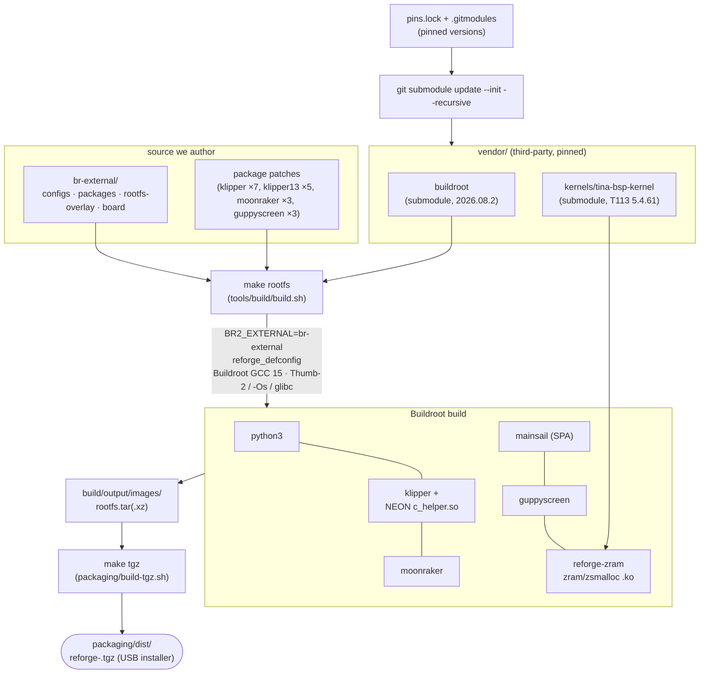
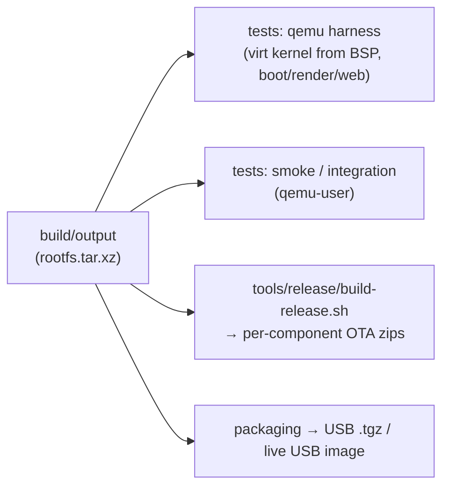

# ReForge build process

How sources become the firmware image. Versions are pinned in `pins.lock` and the
submodule commits; `make rootfs` builds the image through Buildroot and `make tgz`
packages the USB installer.

The Buildroot pin supplies the base packages. ReForge selects OpenSSL 3.5 LTS
through `br-external/local.mk`; the package source hash is in the external
Buildroot patch directory. Updating a base library requires rebuilding the rootfs.

## Host requirements

A Linux x86-64 host with Buildroot's
[system requirements](https://buildroot.org/downloads/manual/manual.html#requirement).
CI (`ubuntu-latest`) installs, in `.github/workflows/release.yml`:

```sh
sudo apt-get install -y build-essential qemu-user-static file xz-utils unzip zip bc \
    cpio rsync socat curl shellcheck busybox python3-pyelftools
```

`qemu-user-static` runs the smoke and integration tests; `shellcheck`, `busybox` and
`python3-pyelftools` serve `make lint unit`. `make live-usb` also needs `sfdisk`
(util-linux), `mtools` and `f2fs-tools`; the `qemu-*` targets need `qemu-system-arm`
([harness README](../tests/qemu-harness/README.md)).

## Pipeline



The `reforge-zram` package builds `zram.ko` and `zsmalloc.ko` from a private copy of
the BSP submodule with the Buildroot toolchain, checks their vermagic against the stock
kernel, and `post-build.sh` places them in `/mod/modules`. The committed
`modules/zram-bsp/dist/*.ko` are only a fallback when that package produced nothing.

Buildroot keeps both `rootfs.tar` and `rootfs.tar.xz`: its compression rule
(`vendor/buildroot/fs/common.mk`) reads the tar and writes a separate `.xz` file.
Packaging consumes the tar; `make repro` compares the compressed archive's contents.

## Steps

| command | does | output |
|---|---|---|
| `git submodule update --init --recursive` | check out Buildroot and the BSP kernel at their pinned commits | `vendor/buildroot`, `vendor/kernels/tina-bsp-kernel` |
| `make defconfig` | apply `reforge_defconfig` to Buildroot | `build/output/.config` |
| `make rootfs` | full Buildroot build: toolchain, device kernel, all packages | `build/output/images/rootfs.tar(.xz)` |
| `make kernel` | build only the Tina BSP 5.4.61 kernel (device config, `-Os`) with Buildroot's gcc 15 | `build/output/images/zImage` |
| `make kernel-virt` | Buildroot virt-config image; the harness instead uses `make qemu-kernel` | `build/output/images/zImage` |
| `make kernel-mainline` | Linux 7.3.5 (`pins.lock`) with `allnoconfig` + `br-external/board/reforge/linux-mainline-t113.config`, failing if any fragment line does not apply. Size proxy: no board DTS, not booted; requires `make rootfs` toolchain or `CROSS_COMPILE` | `build/kernel-mainline/vmlinux` |
| `make tgz` | wrap the rootfs as a stock-format USB installer | `packaging/dist/reforge-<ver>.tgz` |
| `make live-usb` | partitioned live USB image ([live mode](live-mode.md)) | `packaging/dist/reforge-live-<ver>.img.gz` |

`./vendor/fetch.sh` initializes the same submodules and also downloads the pinned
standalone GCC 9.5.0 crosstool. Only the qemu test kernel (`make qemu-kernel` and the
other `tests/qemu-harness/build-test-kernel.sh` targets), `modules/*/build.sh`
(including the f2fs modules `make live-usb` rebuilds when `modules/f2fs-bsp/dist/` is
missing) and `make bsp-kernel-rebuild` use it. On a clean clone run `mkdir -p vendor/toolchains`
first: the script downloads into that directory without creating it. Optional inputs
(Linaro 5.3.1 for `tools/build/build-bsp-kernel-stock.sh` and
`tools/build/build-stock-optee*.sh`, plus caller-supplied stock source archives) are listed in [`vendor/README.md`](../vendor/README.md).

The single `reforge_defconfig` builds the **whole stack** (Klipper, Moonraker, Mainsail,
GuppyScreen, zram, plus `dinit`, shipped as an unwired building block for a future
`switch_root` init). `SCREEN_MODE` picks headless or on-screen at runtime, so there is
one image.

## Consumers of the build



- **Tests** (`tests/`) boot the rootfs under `qemu-system-arm` (the `make qemu-kernel` virt kernel
  from the same BSP source) or `qemu-arm-static`, with no printer. See
  [`tests/README.md`](../tests/README.md).
- **OTA release:** `build-release.sh` slices the same `build/output` into
  per-component zips; see [ota.md](ota.md).

## Reproducibility

`BR2_REPRODUCIBLE=y`, `pins.lock` and the submodule commits fix the inputs. `make repro`
(weekly CI schedule or manual dispatch) builds twice from clean on the same host and compares the mode, size and
SHA-256 of every file in `rootfs.tar.xz`; it does not compare builds across hosts.
Kernel headers are pinned to the stock 5.4.61 ABI so glibc's minimum-kernel note
matches the device (otherwise the loader aborts with `FATAL: kernel too old`).

## Optional Klipper v0.13 host

The default remains Klipper v0.11.0 for the stock AD5M MCU firmware. The separate
`klipper13` package builds the pinned xblax v0.13 AD5M fork, its mainboard firmware and
its toolhead firmware from one source commit, with the MCU compiler, binutils and newlib
also built from source. The host uses the existing `/opt/klipper` path and services;
Kconfig allows only one host package at a time. Use v0.13 only with matching MCU
firmware and a reviewed printer configuration. The package does not flash either MCU
and does not carry the v0.11 stock-firmware tuning patches. Mod comparisons, board
settings, provenance and validation:
[MCU build notes](../br-external/package/klipper13/README.md).

Build it in a separate output directory so no files from the other host version remain:

```sh
repo="$PWD"
out="$repo/build/klipper13"
make -C vendor/buildroot BR2_EXTERNAL="$repo/br-external" O="$out" reforge_defconfig
vendor/buildroot/utils/config --file "$out/.config" \
    --disable BR2_PACKAGE_KLIPPER --enable BR2_PACKAGE_KLIPPER13
make -C vendor/buildroot BR2_EXTERNAL="$repo/br-external" O="$out" olddefconfig
make -C vendor/buildroot BR2_EXTERNAL="$repo/br-external" O="$out" -j"$(nproc)"
```

MCU artifacts appear under `$out/images/klipper13/` and `/opt/klipper/firmware/` in the
target rootfs, with source identity, expanded configs and checksums. `make rootfs`
reapplies the shipping defconfig and selects v0.11.0.
