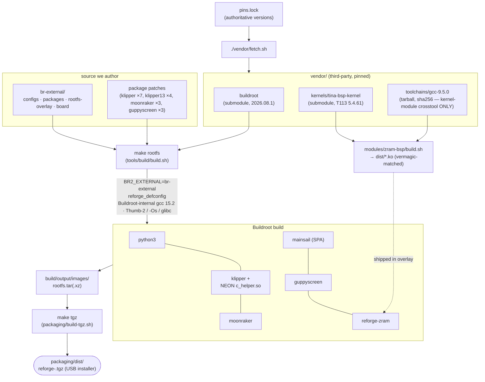
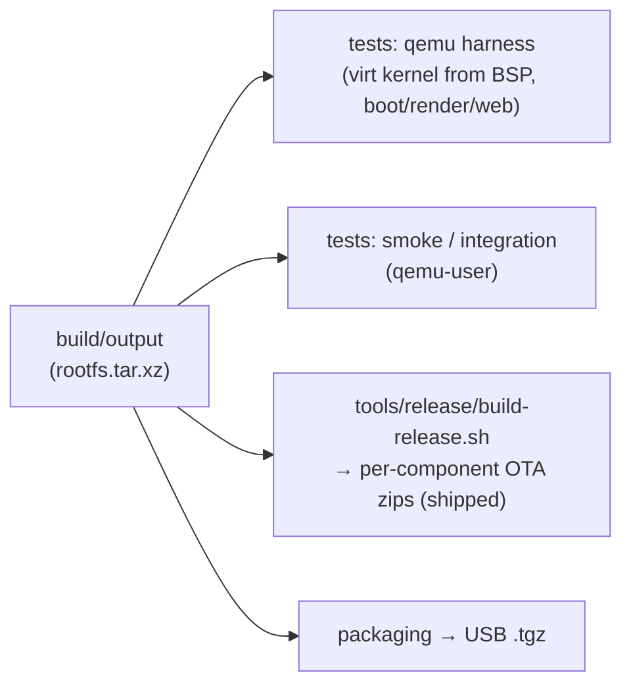

# ReForge build process

How sources become the firmware image. Everything is **pinned** (`pins.lock`) and reproducible:
`vendor/fetch.sh` reconstructs the third-party trees, `make rootfs` builds the rootfs via
Buildroot, and `make tgz` packages the USB installer.

## Pipeline



## Steps

| command | does | output |
|---|---|---|
| `./vendor/fetch.sh` | init submodules (buildroot, BSP kernel) + download+verify the toolchain | `vendor/*` |
| `make defconfig` | apply `reforge_defconfig` to Buildroot | `build/output/.config` |
| `make rootfs` | full Buildroot build (toolchain + all packages) | `build/output/images/rootfs.tar(.xz)` |
| `make kernel` | build the in-tree Tina BSP 5.4.61 kernel (device config, `-Os`) via Buildroot's own gcc-15 toolchain — additive to the standalone `build-bsp-kernel*.sh` scripts | `build/output/images/zImage` |
| `make kernel-virt` | same BSP source, qemu-`virt` config — the bootable test kernel for the harness | `build/output/images/zImage` |
| `make tgz` | wrap the rootfs as a stock-format USB installer | `packaging/dist/reforge-<ver>.tgz` |
| (in `modules/zram-bsp/`) `build.sh` | build zram/zsmalloc `.ko` against the BSP kernel (gcc 9.5 crosstool, vermagic-matched) | `dist/*.ko` (shipped in the overlay) |

The single `reforge_defconfig` builds the **whole stack** (klipper + moonraker + mainsail +
guppyscreen + zram, plus `dinit` — shipped as a future-`switch_root` init building block, not
yet wired); `SCREEN_MODE` picks headless vs on-screen at runtime, so there is one image.

## Consumers of the build



- **Tests** (`tests/`) boot the rootfs under `qemu-system-arm` (a virt-machine kernel built from
  the same BSP source) or `qemu-arm-static` — no printer. See `tests/README.md`.
- **OTA release** (implemented): `build-release.sh` slices the same `build/output` into per-component
  zips — see [`docs/ota.md`](ota.md).

## Reproducibility

`BR2_REPRODUCIBLE=y` + the pinned `pins.lock` + submodule commits make builds deterministic;
`make repro` does a twin-build diff. Kernel headers are pinned to the stock 5.4.61 ABI so the
glibc userland's "min kernel" note matches the device (else the loader aborts `FATAL: kernel too
old`).

## Optional Klipper v0.13 host

The default remains Klipper v0.11.0 for the stock AD5M MCU firmware. The separate
`klipper13` package builds the pinned xblax v0.13 AD5M fork, its mainboard firmware,
and its toolhead firmware from the same source commit. The host uses the existing
`/opt/klipper` path and services. Kconfig allows only one host package at a time.
Use v0.13 only with matching MCU firmware and a reviewed printer configuration;
this package does not flash either MCU or carry the v0.11 stock-firmware tuning patches.
The MCU compiler, binutils and newlib are built from source too. See the
[MCU build notes](../br-external/package/klipper13/README.md) for mod comparisons,
board settings, source provenance and validation.

Build it in a separate output directory to avoid retaining files from another host version:

```sh
repo="$PWD"
out="$repo/build/klipper13"
make -C vendor/buildroot BR2_EXTERNAL="$repo/br-external" O="$out" reforge_defconfig
vendor/buildroot/utils/config --file "$out/.config" \
    --disable BR2_PACKAGE_KLIPPER --enable BR2_PACKAGE_KLIPPER13
make -C vendor/buildroot BR2_EXTERNAL="$repo/br-external" O="$out" olddefconfig
make -C vendor/buildroot BR2_EXTERNAL="$repo/br-external" O="$out" -j"$(nproc)"
```

MCU artifacts appear under `$out/images/klipper13/` and `/opt/klipper/firmware/`
in the target rootfs, with source identity, expanded configs and checksums.

`make rootfs` reapplies the shipping defconfig and selects v0.11.0.
