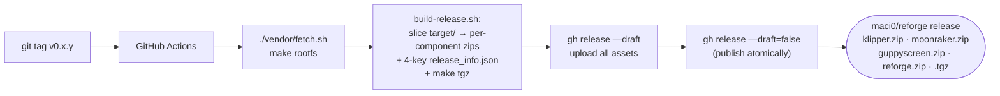
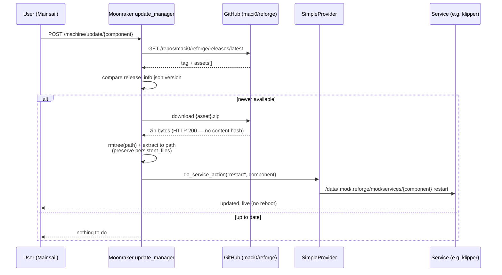
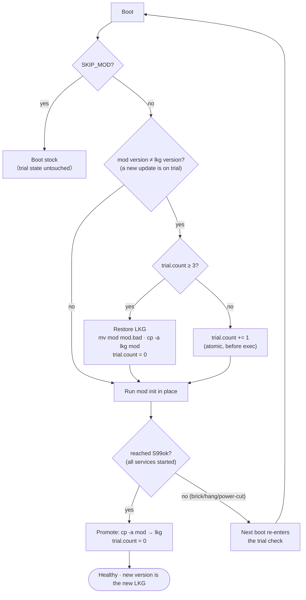

# ReForge OTA / updates

> **Status: implemented.** SimpleProvider patch applied to the shipped Moonraker
> (`br-external/package/moonraker/0001-add-simple-service-provider.patch`); five
> `[update_manager <component>]` blocks configured in
> `etc/reforge/moonraker.conf` (`provider: simple` for klipper/moonraker/
> guppyscreen/reforge; `type: web` for mainsail; `enable_auto_refresh: False`);
> trial / last-known-good rollback live in `.shell/reforge-lkg.sh` +
> `reforge-boot` + `S99ok` sentinel; release pipeline in `tools/release/build-release.sh`
> + `.github/workflows/release.yml`. End-to-end gate `make qemu-ota`
> (`tests/qemu-harness/ota-test.sh`) exercises both the Moonraker update path
> and the N=3 brick-rollback. Full design + rationale:
> [`docs/specs/2026-06-01-reforge-ota-design.md`](specs/2026-06-01-reforge-ota-design.md);
> implementation plan: [`docs/plans/2026-06-01-reforge-ota.md`](plans/2026-06-01-reforge-ota.md).

Git-free in-place updates via Moonraker's `update_manager`, against **self-published prebuilt
release bundles**. The device ships no `git`, no `pip`, no compiler — updates need none of them.
The model follows forge-x (per-component updaters, `SimpleProvider` live restart) and adds an
automatic last-known-good rollback.

## What updates how

| component | updater | source | applies via |
|---|---|---|---|
| `klipper` `/opt/klipper` (incl. prebuilt `c_helper.so`) | `zip` | `maci0/reforge` release asset | `SimpleProvider` restart |
| `moonraker` `/opt/moonraker` | `zip` | `maci0/reforge` | restart |
| `guppyscreen` `/opt/guppyscreen` | `zip` | `maci0/reforge` | restart |
| `reforge` `/data/.mod/.reforge/mod` (init, configs, zram `.ko`, banner) | `zip` | `maci0/reforge` | restart / next boot, under trial/LKG |
| `mainsail` `/var/www/mainsail` | `web` | upstream `mainsail-crew/mainsail` | static, no restart |

**Out of scope (USB `.tgz` reflash):** base rootfs (busybox/glibc), kernel, U-Boot.

## Release pipeline (CI)

One tag = one Release carrying N zip assets. Each zip embeds a `release_info.json`
(`project_name`, `project_owner`, `version`, `asset_name`) at its root so the device knows the
installed version. Draft-then-publish avoids a device seeing the tag before all assets upload.

## Update flow (device)

Updates are **manual** (`enable_auto_refresh: False`, like forge-x). `SimpleProvider`
(ported from forge-x) lets `provider: simple` restart init.d services live — no reboot for
`/opt` components. The `reforge` overlay component applies under the trial/LKG guard below.

## Safety — boot trial + last-known-good (LKG)

Updating the overlay/init can break boot — which Moonraker can't fix (it wouldn't be running).
So `reforge-boot` guards the `reforge` component with a trial counter + an LKG snapshot. (App
rollback for `/opt` components: the boot LKG is the rollback — Moonraker's built-in rollback is
unreliable for our multi-asset release, see the spec.)

- **Trial counter** `/data/.mod/.reforge/state/trial.count` — atomic writes (temp + rename), survives
  power-cuts.
- **N = 3** failed trial boots → restore the previous LKG.
- **Sentinel** = the single `S99ok` init script (runs last); reaching it means every service
  started → promote the current `mod` to LKG.
- **Integrity:** the updater verifies only the HTTP status (no content hash — same as the whole
  Klipper ecosystem). A corrupt or boot-breaking update is caught by the trial/LKG, not at
  download.
- **`SKIP_MOD`** USB marker = the final manual escape (boot stock entirely); orthogonal to the
  trial state.

## Why not `git_repo`?

Moonraker's `git_repo` updater needs the full `git` CLI (clone/fetch/checkout/reset/describe/
rev-parse/for-each-ref/fsck/… incl. partial clone) and, on a buildroot image, would still fail:
`/opt/*` aren't git checkouts, there's no `pip` for Moonraker deps, and no `gcc` (klipper's
chelper recompiles on source change). The `zip`/`web` updaters need only Moonraker's HTTP client
+ stdlib `zipfile`. Full analysis: [`docs/BACKLOG.md`](BACKLOG.md).
