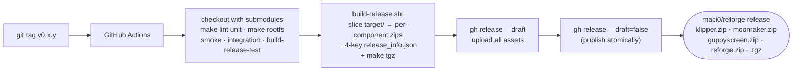
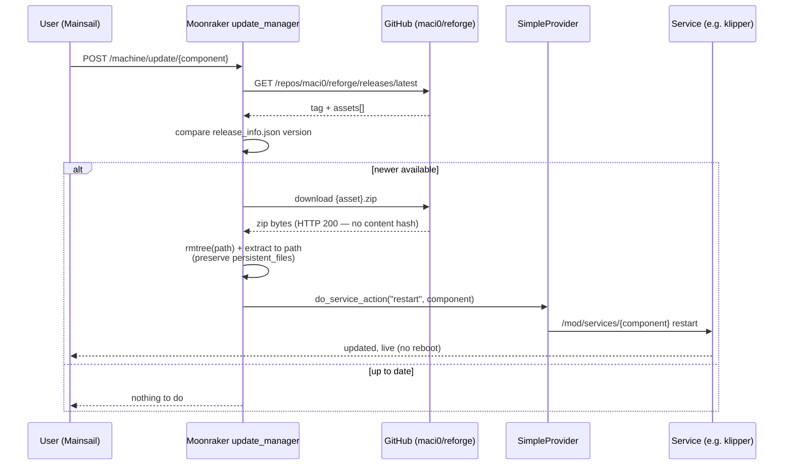
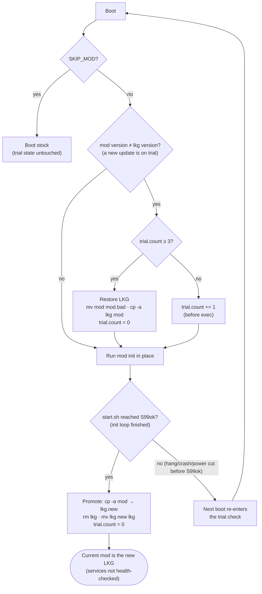

# ReForge OTA / updates

> **Status: implemented.** Two of the shipped Moonraker patches provide the update path:
> `0001-add-simple-service-provider.patch` (SimpleProvider) +
> `0002-zip-updater-for-reserved-apps.patch` (enables `type: zip` updates for the
> reserved klipper/moonraker app names the table below relies on);
> `0003-lazy-import-update-backends.patch` only defers loading the unused Git,
> Python-package and PackageKit backends until one is selected. Five
> `[update_manager <component>]` blocks configured in
> `etc/reforge/moonraker.conf` (`type: web` for mainsail, zip for the rest;
> `[machine] provider: simple` restarts the services; `enable_auto_refresh: False`);
> trial / last-known-good rollback live in `.shell/reforge-lkg.sh` +
> `reforge-boot` + `S99ok` sentinel; release pipeline in `tools/release/build-release.sh`
> + `.github/workflows/release.yml`. `make qemu-ota` (`tests/qemu-harness/ota-test.sh`,
> local only) gates on the N=3 rollback and the Mainsail bundle check; its Moonraker update
> step is best-effort and may SKIP or fail without failing the run, and missing build
> prerequisites exit 0 with `SKIP`. Read the log for an observed `PASS`, not the exit code.
> Full design + rationale:
> [`docs/specs/2026-06-01-reforge-ota-design.md`](specs/2026-06-01-reforge-ota-design.md);
> implementation plan: [`docs/plans/2026-06-01-reforge-ota.md`](plans/2026-06-01-reforge-ota.md).

Git-free in-place updates via Moonraker's `update_manager`, against **self-published prebuilt
release bundles**. The device ships no `git`, no `pip`, no compiler — updates need none of them.
The model follows forge-x (per-component updaters, `SimpleProvider` live restart) and adds an
automatic last-known-good rollback.

## What updates how

| component | updater | source | applies via |
|---|---|---|---|
| `klipper` `/opt/klipper` (incl. prebuilt `c_helper.so`) | `zip` | `maci0/reforge` release asset | `SimpleProvider` restart |
| `moonraker` `/opt/moonraker` | `zip` | `maci0/reforge` | restart |
| `guppyscreen` `/opt/guppyscreen` | `zip` | `maci0/reforge` | restart |
| `reforge` `/mod` (init, configs, zram `.ko`, banner) | `zip` | `maci0/reforge` | restart / next boot, under trial/LKG |
| `mainsail` `/var/www/mainsail` | `web` | upstream `mainsail-crew/mainsail` | static, no restart |

**Not updated by OTA:** the chroot base rootfs (busybox/glibc) needs a new USB `.tgz`
install. The active installed boot hook and chroot helper also need a `.tgz` reinstall:
OTA updates their `/mod/.shell/` copies, while installed boot uses the separate
rootfs-level `/.shell/reforge-boot` and `/.shell/reforge-chroot.sh`. Paths in the table
are inside the chroot; installed `/mod` is `/data/.mod/.reforge/mod` on the host.
The stock kernel and U-Boot are never touched by OTA or the `.tgz` installer.

## Release pipeline (CI)

One tag = one Release carrying four zips and the `.tgz`; the live USB image is not a
release asset. Each zip embeds a `release_info.json`
(`project_name`, `project_owner`, `version`, `asset_name`) at its root so the device knows the
installed version. Draft-then-publish avoids a device seeing the tag before all assets upload.

## Update flow (device)

Updates are **manual** (`enable_auto_refresh: False`, like forge-x). `SimpleProvider`
(ported from forge-x) lets `provider: simple` restart init.d services live — no reboot for
`/opt` components. The `reforge` overlay component applies under the trial/LKG guard below.

## Safety — boot trial + last-known-good (LKG)

Updating the overlay/init can break boot, which Moonraker can't fix (it wouldn't be running).
So `reforge-boot` guards the `reforge` component (`/data/.mod/.reforge/mod`) with a trial
counter and an LKG copy of that directory. The `/opt` components (`klipper`, `moonraker`,
`guppyscreen`) have no ReForge rollback: the LKG copies only `mod`, and Moonraker's built-in
rollback is unreliable for this multi-asset release (see the spec).

- **Trial counter** `/data/.mod/.reforge/state/trial.count`, written to a temp file and renamed
  over the old one. There is no `fsync`, so durability across a power cut is not proven.
- **N = 3:** a trial (a `mod` whose version differs from `lkg`) that fails to reach `S99ok`
  three times is replaced by the previous LKG.
- **Sentinel** = `S99ok`, the last script `start.sh` runs. `start.sh` runs the S-scripts with
  `set +e` and the daemons start in the background, so reaching `S99ok` means the init loop
  finished, not that the services are healthy. A crashing Klipper or Moonraker still gets
  promoted.
- **Copies are not atomic:** promote builds `lkg.new`, then `rm -rf lkg` and `mv`; restore is
  `mv mod mod.bad` then `cp -a lkg mod`. An interruption in either step can leave a missing
  or partial directory. The promote helper attempts to reset the counter even if the copy
  or rename fails.
- **Integrity:** the updater checks only the HTTP status (no content hash, as in the rest of the
  Klipper ecosystem). A corrupt update is caught only if it stops boot before `S99ok`; nothing
  detects one that boots.
- **`SKIP_MOD`** marker (`/tmp/SKIP_MOD*` or `/data/.mod/.reforge/SKIP_MOD`) = the final manual
  escape: skip ReForge while present. `/tmp` markers last one boot; the `/data`
  marker persists until removed. This is orthogonal to trial state.

> **Planned successor:** the `cp -a mod ↔ lkg` / `mv mod mod.bad` directory dance above is slated to
> be replaced by a **versioned-OverlayFS pointer-swap** (`versions/<ver>/` + a `current` symlink),
> designed to make update + rollback atomic while reusing this trial/LKG logic. Design:
> [`plans/2026-06-05-immutable-reforge.md`](plans/2026-06-05-immutable-reforge.md) (not yet
> implemented — the LKG dir-dance documented here is what ships today).

## Why not `git_repo`?

Moonraker's `git_repo` updater needs the full `git` CLI (clone/fetch/checkout/reset/describe/
rev-parse/for-each-ref/fsck/… incl. partial clone) and, on a buildroot image, would still fail:
`/opt/*` aren't git checkouts, there's no `pip` for Moonraker deps, and no `gcc` (klipper's
chelper recompiles on source change). The `zip`/`web` updaters need only Moonraker's HTTP client
+ stdlib `zipfile`. A minimal git client was considered and deferred: [BACKLOG](BACKLOG.md#microgit--a-tiny-git-client-zig-for-moonrakers-update_manager).
