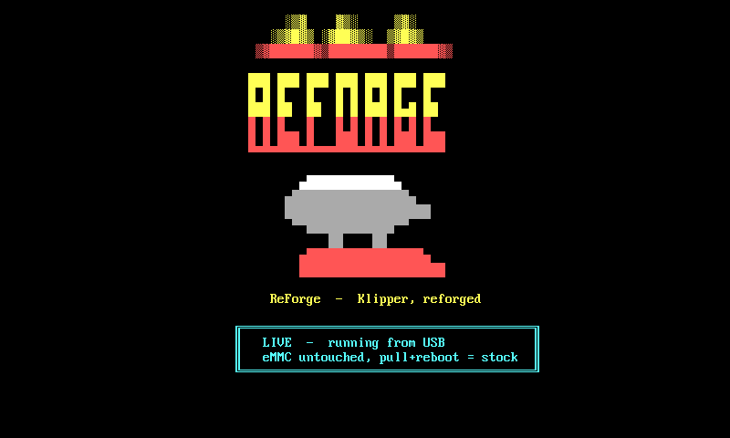
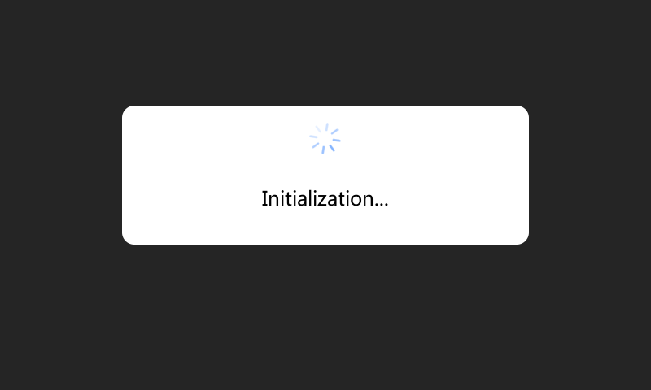
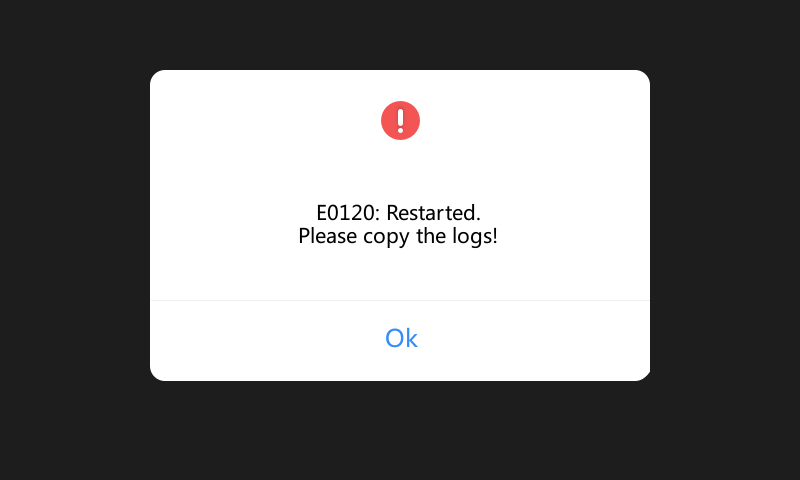
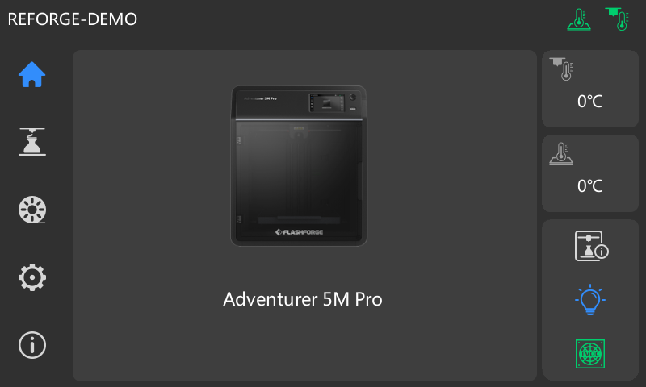

# Screenshots

All images are captured from `qemu-system-arm` with `/dev/fb0` pinned to the printer's exact
panel (**800×480, 32 bpp**), via the QEMU monitor `screendump` — **pixel-identical to the real
4.3" screen**. The boot splash + console are real framebuffer-console captures (16-color VGA/CP437
fbcon, not rasterized approximations) produced by `tests/qemu-harness/shots-reforge.sh`
(`make shots-reforge`), which injects the working-tree banner, boots the virt kernel with
virtio-gpu, and screendumps the live fbcon.

## Bootsplash (fire/ember "ReForge")

The fire/ember banner from `board/reforge/rootfs-overlay/usr/bin/reforge-banner` — shown on the
boot console (via `reforge-boot`) and on interactive login (`/etc/profile.d`). Block-glyph
REFORGE wordmark in a fire gradient, shaded-block flames, a steel anvil over the forge base,
tagline *"ReForge - Klipper, reforged"*. Drawn with VGA/CP437 console glyphs only (`█ ▓ ▒ ░ ▀ ▄`,
single/double box) so every glyph exists in the framebuffer console font; 256-color ANSI that the
16-color fbcon maps to the fire palette (yellow→red), degrading to plain text on dumb terminals.
Self-centres to the console width and fits the 30-row console without scrolling.

### LIVE mode

In [live mode](../live-mode.md) the launcher sets `REFORGE_LIVE=1` and drops a `/run/reforge-live`
marker, so the banner adds a cyan badge — **running from USB · eMMC untouched · pull+reboot =
stock** — making the run-from-USB state obvious on the panel and at every login.

## Boot process

The ReForge userspace boot sequence: cloud-block → sysctl → **zram swap (active)** → klipper →
moonraker → busybox httpd (Mainsail) → guppyscreen → `Welcome to ReForge`. The qemu **virt** test
kernel now carries zram built-in, so `/dev/zram0` is present and the swap activates (zstd, 256M)
exactly as on the real stock kernel — the stock-built `zram.ko` still vermagic-mismatches and is
skipped first, then S35zram falls back to the built-in device (see `modules/zram-bsp/`).

## GuppyScreen (ReForge's on-screen UI) — PARKED (renders blank in qemu)

**Status: not captured — known limitation, parked.** The committed shot is blank (2 colours).

The full stack *does* come up: `tests/qemu-harness/guppy/fake-klippy.py` is a Moonraker-grade
Klipper API stand-in that completes Moonraker's handshake as **ready** with no MCU. Verified —
Moonraker reports `klippy_connected:true, klippy_state:"ready", missing_klippy_requirements:[]`
and GuppyScreen connects, subscribes to the full object set, and logs `done init`. Yet
GuppyScreen never paints `/dev/fb0` — confirmed by dumping the framebuffer **in-guest** to a
second disk (genuinely black, so it is *not* a scanout-flush issue; the fb geometry is a correct
800×480×32). Pushing `process_status_update` events (so Moonraker emits `notify_status_update`)
did not change it either.

So this is a GuppyScreen **LVGL display-backend** issue under qemu's virtio-gpu, independent of
the printer-ready simulation. It likely needs real panel hardware or a guppy/LVGL-driver rebuild.
`make qemu-guppy` is still useful as a **full-stack "ready" rig** for Moonraker/OTA/API testing
even though the on-screen capture is blank. The reforge-render path (`make qemu-render`) is the
older non-blank attempt (also blank without a ready klippy).

## Stock UI boot phases (`firmwareExe`) under simulated hardware

The stock UI boot is ~90 s in qemu. Sampling the framebuffer across that window
(`tests/qemu-harness/shots-capture.sh`, screendumps at t = 4/8/12/18/25/40/60/90 s plus a
finer 18–30 s pass) yields a handful of visually distinct phases. Each frame is the pinned
**800×480** panel, captured exactly like the home shot below (rootless slice + sim + screendump).

### Phase 1 — loading / connecting ("Initialization…")

The first thing `firmwareExe` paints: a dark canvas with the centred **"Initialization…"** card and
spinner, shown while it brings up Qt/QWS on `/dev/fb0` and waits on the eboard serial handshake +
klippy. (There is no separate green FlashForge bootlogo in this path — the Qt app owns the
framebuffer from a dark background straight through to the home screen.)

### Phase 2 — transient restart notice ("E0120: Restarted")

Mid-boot under qemu, `firmwareExe` self-restarts once and surfaces an **"E0120: Restarted. Please
copy the logs!"** dialog before recovering. Captured honestly as a real boot-time state — it clears
on its own and the UI proceeds to the home screen below. (On real hardware this is the watchdog/
recovery notice; here it's the in-qemu restart on the way up.)

## Stock UI (`firmwareExe`) — full home screen under simulated hardware

The stock FlashForge UI booted all the way to its **clean home screen** in qemu: nav rail
(home / print / settings / info), the Adventurer 5M Pro printer art, live nozzle + bed
temperature panels, light/network/camera tiles — fully interactive, no overlay dialogs. ReForge
overlays the stock base, so the stock UI binary (`/opt/PROGRAM/.../firmwareExe`, soft-float
Qt4/QWS) and its Qt + tslib libs run straight from that base — no extraction, no recompile.

The render scrubs captured device state from the dump and clears the boot dialogs:
- `/opt/config/PowerOff` (a power-loss-recovery flag) is removed — else a *"recovery print?"* modal;
- the real serial in `/opt/config/Adventurer5M.json` → `REFORGE-DEMO` (top-left);
- `general.CheckAppFrist` → `false` in the same JSON — clears the *"upgrade the slicer to V1.7.3"*
  nag (root-caused to firmwareExe's `checkAppTip()`; the same one-line fix ships to forge-x);
- firmwareExe still does **one** self-restart in qemu (a watchdog artifact → the *E0120: Restarted*
  modal); the harness synthesises an **Enter** keypress via a virtio keyboard to dismiss it,
  leaving the clean home screen above.

Getting past startup needs **two gates satisfied** (firmwareExe checks them independently):
1. an **eboard MCU serial handshake** on `/dev/ttyS1` (+`/dev/ttyS5`) @230400 — qemu virt has no
   8250 UART, so `tests/qemu-harness/stockui/mcu-sim.py` emulates a gcode MCU on a pty;
2. a **klippy "ready"** reply on `/tmp/uds` — `tests/qemu-harness/stockui/fake-klippy.py` serves
   the JSON-RPC subset firmwareExe polls.

Reproduce with **`make qemu-stockui`** (fully rootless — debugfs inject + GPT-offset rootfs slice
+ unprivileged qemu). Capture lands at `tests/qemu-harness/build/stockui-home.ppm`.

### Without the MCU sim — the "No detected eboard mcu." modal

Booting the same stock base with **no** MCU sim stops at firmwareExe's
**"No detected eboard mcu."** modal (gate 1 unmet) — the green/white dialog that motivated the
simulation above. Full works/breaks analysis: `docs/research/ui-camera/2026-06-01-stock-ui-spike.md`.
