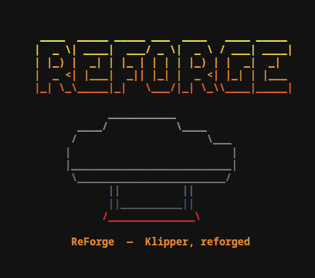
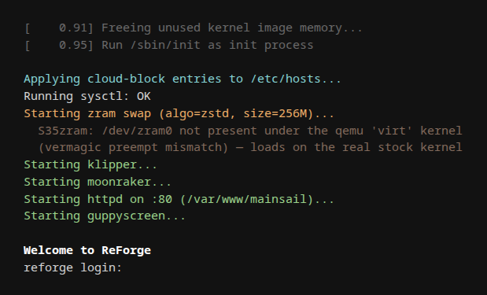
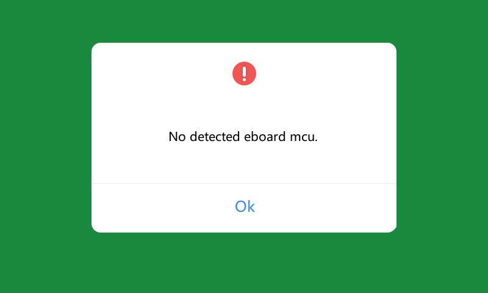

# Screenshots

GUI renders are captured from `qemu-system-arm` with `/dev/fb0` pinned to the printer's exact
panel (**800×480, 32 bpp**), via the QEMU monitor `screendump` (see
`tests/qemu-harness/README.md`) — **pixel-identical to the real 4.3" screen**. The boot
images are rendered from the actual qemu serial capture / the in-repo banner script.

## Bootsplash (fire/ember "ReForge")

The fire-gradient banner from `board/reforge/rootfs-overlay/usr/bin/reforge-banner` — shown on
the boot console (via `reforge-boot`) and on interactive login (`/etc/profile.d`). Steel anvil,
ember-hot base, tagline *"ReForge — Klipper, reforged"*. 256-color ANSI; degrades to plain text
on dumb terminals.

## Boot process

The real ReForge userspace boot sequence captured from the qemu serial: cloud-block → sysctl →
zram swap → klipper → moonraker → busybox httpd (Mainsail) → guppyscreen → `Welcome to ReForge`.

> The zram line shows skipped here because the qemu **virt** test kernel is built without
> `PREEMPT`, so the stock-built `zram.ko` vermagic mismatches. On the **real stock 5.4.61
> kernel** the module matches and zram swap activates (see `modules/zram-bsp/`).

## GuppyScreen (ReForge's on-screen UI)

ReForge booted in qemu with `SCREEN_MODE=GUPPY`. GuppyScreen (native LVGL) renders to
the pinned 800×480 framebuffer. No MCU in qemu → klippy is in `error`/waiting, so
GuppyScreen shows its connecting/offline state — which still proves the full render
path works (LVGL → DRM/virtio-gpu fbdev → `/dev/fb0`). Regenerate with `make qemu-render`.

## Stock UI (`firmwareExe`) — running on the ReForge-overlaid stock base

ReForge overlays the stock FlashForge base: the stock UI binary (`/opt/PROGRAM/.../firmwareExe`,
soft-float Qt4/QWS) and its Qt + tslib libs live in that base, so ReForge's planned `STOCK`
screen mode just bind-mounts the base and execs it — no extraction, no recompile. Booted under
the same virt kernel + 800×480 fb the rest of these shots use.

What renders is firmwareExe's modal **"No detected eboard mcu."** — the expected qemu state
(no eboard MCU serial is emulated), the stock-UI analogue of GuppyScreen's offline/connecting
screen. It proves the full stock render path (Qt4 LinuxFB → `/dev/fb0`): FF-green chrome,
white dialog, red alert glyph, blue *Ok* — 435 distinct colors. The native panel is 480×800
portrait; Qt centres the dialog within the landscape test fb.

Regenerate by building the stock rootfs (`make qemu-stock-rootfs`, from `golden.img.gz`) and
booting it; the capture lands at `tests/qemu-harness/build/stockui-screenshot.ppm`. Full
works/breaks analysis: `docs/research/stock-ui-spike.md`.
